<div align="center">

# NightRoll

### Hostel attendance, marked from your bed.

Prove the **right person**, in the **right room**, on the **right device**, inside the **warden's window** — with no new hardware.


</div>

---

## Table of contents

- [The problem](#the-problem)
- [The solution](#the-solution)
- [Tech stack](#tech-stack)
- [System architecture](#system-architecture)
- [Verification pipeline](#verification-pipeline)
- [One night, end to end](#one-night-end-to-end)
- [Enrollment](#enrollment)
- [Trust score](#trust-score)
- [Geofencing with WiFi](#geofencing-with-wifi)
- [Threat model](#threat-model)
- [Data model](#data-model)
- [Deployment](#deployment)
- [Privacy](#privacy)
- [Demo plan](#demo-plan)
- [Roadmap](#roadmap)
- [Getting started](#getting-started)
- [Repository layout](#repository-layout)
- [Project status](#project-status)
- [License](#license)

---

## The problem

Every night at 10:00 PM, every hosteller walks down to the ground floor to scan their face at a single attendance point. Students on the first, second, third and higher floors all queue at the same scanner.

- One scanner serves the whole hostel, so there is a queue every night.
- Students leave their rooms and climb back up just to prove they are in the building.
- The check proves you were at the ground floor at 10:00 PM. It says nothing about whether you stayed.

## The solution

NightRoll moves the check to the student's phone and the hostel's existing per-room WiFi. At 10 PM the student opens NightRoll and completes a short face check in bed, and the room tile turns green on the warden's dashboard.

A selfie alone would be easy to fake, so every mark has to prove three things at once:

| Proof | How | What it stops |
|---|---|---|
| **Right person** | Face match plus a random liveness challenge | Someone else marking for you, photos, replayed video |
| **Right place** | Request arrives from your room's subnet, backed by a WiFi fingerprint of the room | Marking from outside the hostel, VPN tunnelling |
| **Right device, right now** | A hardware-bound key signs a one-time nonce issued for tonight's window | Marking from a friend's phone, replaying yesterday's request |

No single factor is trusted on its own. The existing ground-floor scanner stays as the fallback.

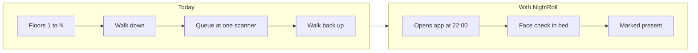

---

## Tech stack

**Mobile app**


**Backend**


**Face and liveness**


**Data**


**Dashboard and delivery**


| Layer | Choice | Why |
|---|---|---|
| App | React Native, VisionCamera, ML Kit | One codebase, fast camera pipeline, on-device face detection |
| On-device ML | TFLite MobileFaceNet | Quick pre-check so a bad capture fails before upload |
| Device trust | Android Keystore / StrongBox, Play Integrity | Key never leaves the chip; blocks root, emulators, virtual cameras |
| API | FastAPI | Async, typed, fast to build |
| State | Upstash Redis (hosted, TLS) | Nonces and window state with native TTL, no local server to run |
| Face | InsightFace `buffalo_l` on ONNX Runtime | Strong open ArcFace embeddings, runs on CPU |
| Database | Supabase (PostgreSQL with pgvector) | Relational data and 512-dimension embeddings in one managed database |
| Auth | Supabase Auth | Warden and admin login with MFA; student devices are bound by Keystore keys, not passwords |
| Frame storage | Supabase Storage (private bucket) | Encrypted, short-lived frames with a 24-hour deletion job |
| Network verify | Subnet check, then controller API or RADIUS accounting | Starts simple, upgrades without app changes |
| Dashboard | React over WebSocket | Room tiles update live |
| Window status | Pulled from the API when the app opens | No push service; students open the app at window time |

---

## System architecture

Four zones: the phone gathers evidence, the hostel network vouches for location, the backend decides, and the outputs inform the student and the warden.

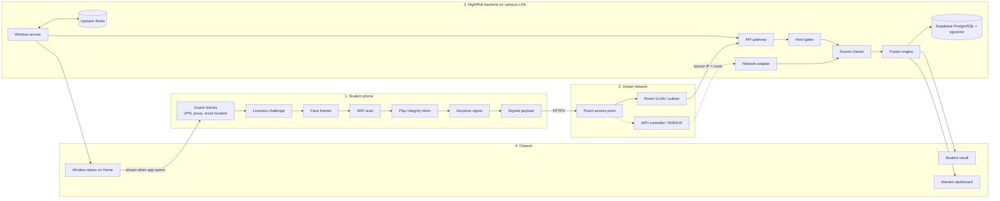

### Backend components

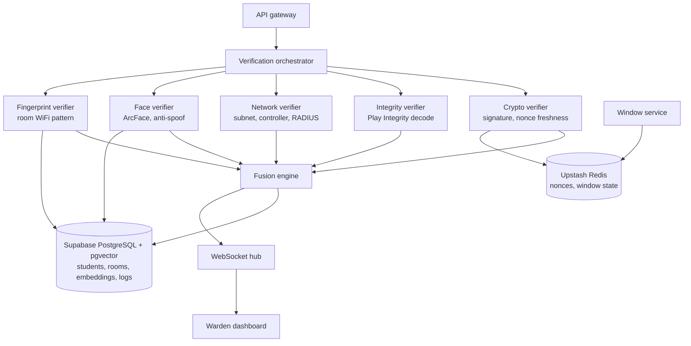

---

## Verification pipeline

Hard gates run first. Any single failure rejects the mark before a face is ever compared. Only marks that pass every gate are scored.

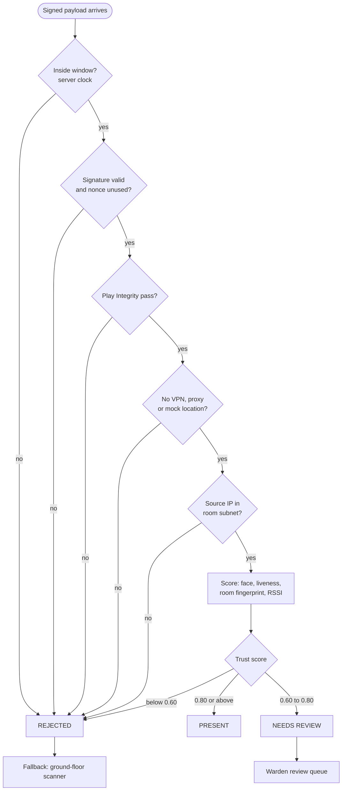

| Gate | Defeats |
|---|---|
| Server-clock window | Changing the phone's time |
| Signature and fresh nonce | A friend's phone, replayed requests |
| Play Integrity | Rooted devices, emulators, virtual cameras |
| No VPN, proxy or mock location | Tunnelling in from outside |
| Room subnet source IP | Any request from off the hostel network |

---

## One night, end to end

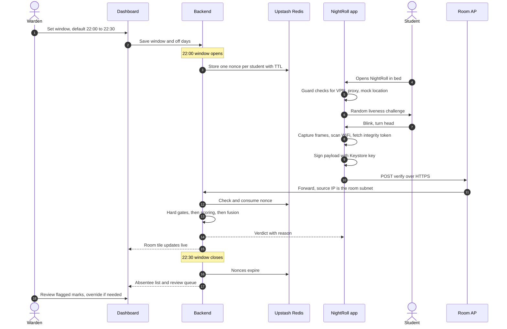

### Attendance states

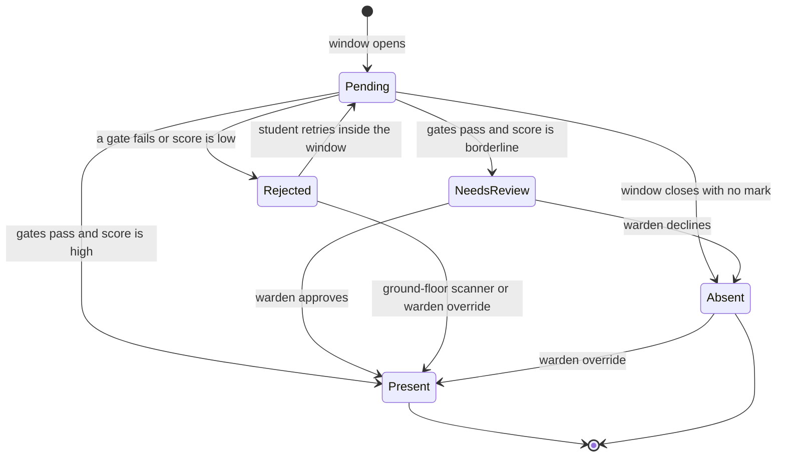

---

## Enrollment

Enrollment happens once, in person, at the warden's office. That is what makes the later remote checks trustworthy.

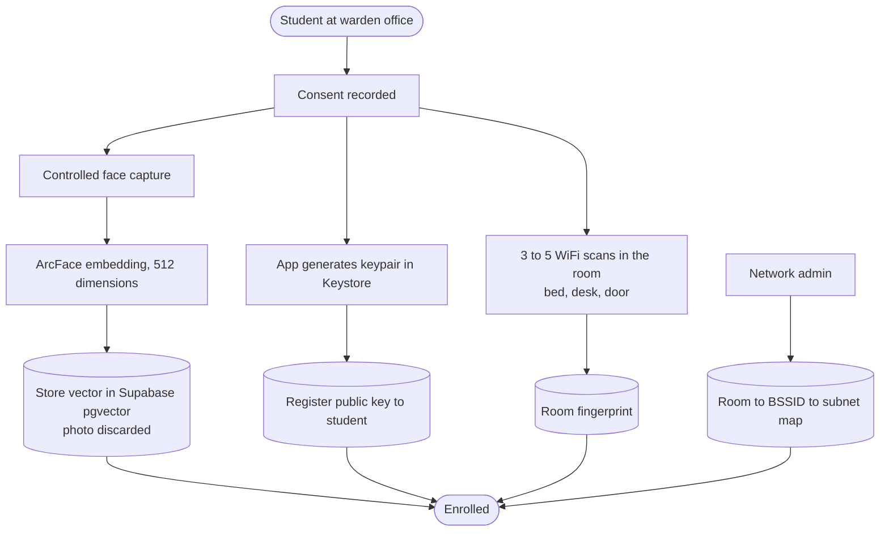

- **Face:** only the embedding is stored. The enrollment photo is discarded.
- **Device:** the private key is generated inside the phone's secure hardware and never leaves it. A new phone means re-enrolling the device.
- **Room:** one student scans the room; roommates share the same room fingerprint.

---

## Trust score

Marks that pass every gate are scored from five signals.

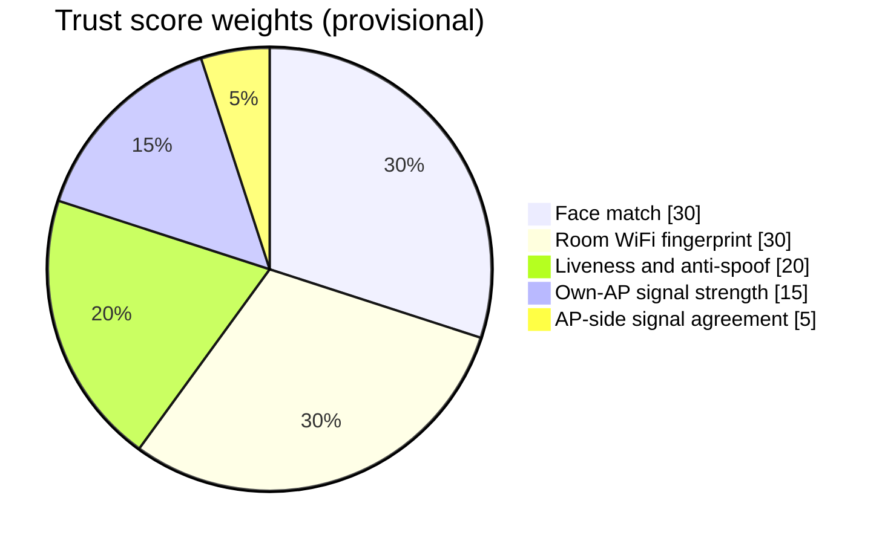

| Signal | Weight | What it measures |
|---|---|---|
| Face match | 0.30 | Cosine similarity between tonight's embedding and the enrolled one |
| Room WiFi fingerprint | 0.30 | How closely tonight's scan matches the room's saved pattern |
| Liveness and anti-spoof | 0.20 | Challenge completed, and the face is not a photo or a screen |
| Own-AP signal strength | 0.15 | The room's own router is seen at room-level strength |
| AP-side signal agreement | 0.05 | The router's view of the phone agrees with the phone's report |

| Score | Verdict | What happens |
|---|---|---|
| 0.80 or above | **PRESENT** | Recorded; room tile turns green |
| 0.60 to 0.80 | **NEEDS REVIEW** | Goes to the warden's review queue |
| Below 0.60 | **REJECTED** | Student sees the reason and can retry or use the ground-floor scanner |

> [!NOTE]
> These weights and cutoffs are starting values. They will be tuned against real measurements from the hostel (see the walk test below) before anyone relies on them.

---

## Geofencing with WiFi

GPS cannot tell one room from the next indoors, and it is easy to fake. NightRoll uses the WiFi itself as the fence.

Every spot in the hostel sees the surrounding routers differently. Inside room 203, the room's own router is very strong, the neighbours are medium, the corridor is weak. Outside the compound wall, most hostel routers vanish and unfamiliar networks appear. That pattern is the room's fingerprint.


### Calibrating with a walk test

Limits are measured, not guessed.

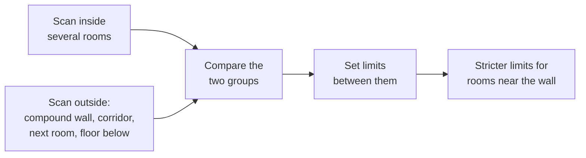

### Keeping fingerprints fresh

- **Slow drift:** confident "present" marks are blended into the saved fingerprint. Borderline marks never are, so a cheater cannot teach the system a wrong pattern.
- **Router replaced:** the warden triggers a re-scan for that room.
- **Stale fingerprint:** repeated reviews from one room flag it on the dashboard.

### Supporting layers

| Layer | Role |
|---|---|
| Router minimum-signal setting | The router drops weak clients, so distant phones cannot stay connected |
| Router-side signal check | A large gap between the router's reading and the phone's report suggests a faked scan |
| 5 GHz signal | Blocked by walls more than 2.4 GHz; used as evidence if the walk test shows it helps, not as a rule |
| GPS | A warning only, and only when accurate and clearly outside the hostel |

---

## Threat model

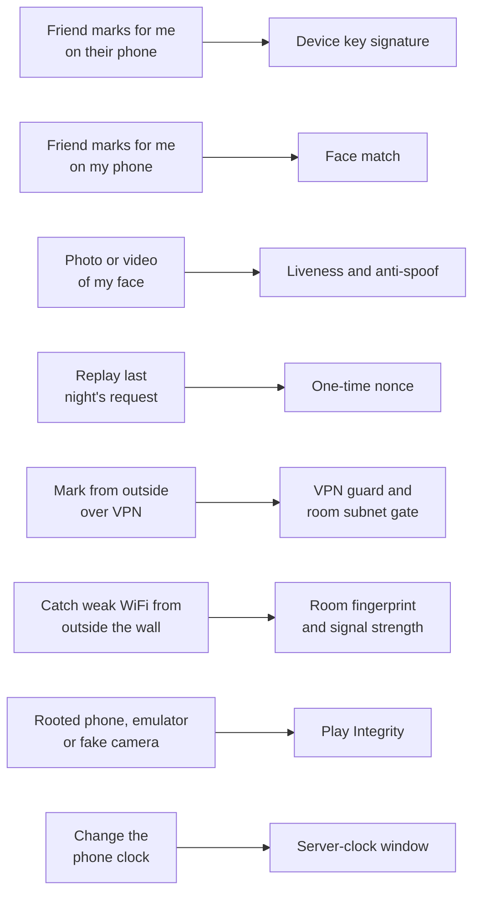

| Limitation | Handling |
|---|---|
| Student marks present, then leaves | Out of scope for the first release; random spot-checks are on the roadmap |
| Phone dead, no WiFi, router down | Ground-floor scanner stays as the fallback |
| iPhones cannot do full WiFi scans | Android first; iPhone users keep the ground-floor scanner |
| Hostel network does not expose subnets or a controller API | Needs the network admin; the design degrades to fingerprint plus review |

---

## Data model

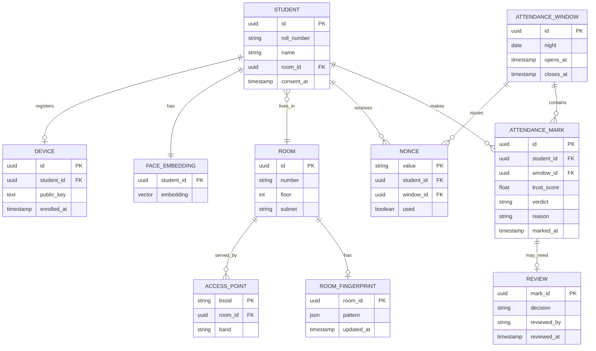

Nonces live in Upstash Redis with a TTL that ends when the window closes. They are shown here for the relationships only.

---

## Deployment

The backend sits on the campus LAN so the source IP of every request is the student's real room address.

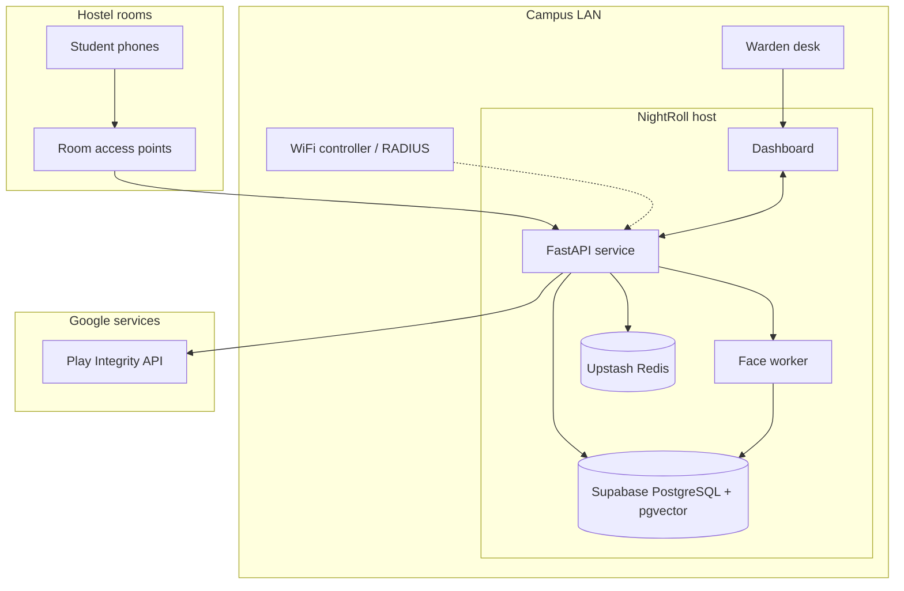

---

## Privacy

Face data is sensitive, so the rules are fixed from the start.

- **Consent first.** Enrollment requires explicit, recorded consent.
- **Embeddings, not photos.** Only the numeric face embedding is stored.
- **Short-lived frames.** Frames captured for a nightly check are deleted within 24 hours.
- **No biometric logging.** Embeddings and raw frames never appear in logs.
- **Reasons shown.** A student always sees why a mark was rejected or sent to review.
- **A human decides the edge cases.** The warden can override any automatic verdict.

---

## Demo plan

Two ordinary routers stand in for Room 101 and Room 102, each on its own subnet.

| # | Action | Expected result |
|---|---|---|
| 1 | Mark from the Room 101 router | **PRESENT**; the tile turns green |
| 2 | Switch to the Room 102 router | **REJECTED** at the room subnet gate |
| 3 | Hold up a photo or a video of the face | **REJECTED** by liveness |
| 4 | Mark from a teammate's phone | **REJECTED**; signature does not match |
| 5 | Walk out of the building while still on WiFi | **REJECTED**; WiFi pattern does not match the room |

Production plugs into the hostel's existing WiFi controller or RADIUS. No new hardware is required.

---

## Roadmap

```mermaid
flowchart LR
    subgraph M1["MVP: hackathon"]
        direction TB
        a1["Signed nonce per student"]
        a2["Room subnet gate"]
        a3["Face match and liveness challenge"]
        a4["Dashboard with room tiles"]
    end
    subgraph M2["Next"]
        direction TB
        b1["WiFi fingerprint and walk test"]
        b2["Passive anti-spoof model"]
        b3["Controller or RADIUS adapter"]
    end
    subgraph M3["Later"]
        direction TB
        c1["Random spot-checks"]
        c2["Anomaly detection"]
        c3["ERP export, iOS support"]
    end
    M1 --> M2 --> M3
```

## Getting started

### Prerequisites

Install these once. The commands are for macOS with Homebrew; Windows and Linux users can use the official installers.

| Tool | Version | Needed for | Install |
|---|---|---|---|
| Git | any recent | Source control | `brew install git` |
| Python | 3.12 | Backend, face worker | `brew install python@3.12` |
| Node.js | 20 LTS | Dashboard, app tooling | `brew install node@20` |
| JDK | 17 | Android build | `brew install openjdk@17` |
| Android Studio | current stable | Android SDK, emulator | developer.android.com/studio |
| Docker Desktop | current stable | Later services (Phase 12); not needed for Redis | docker.com, then start it |
| Supabase CLI | current stable | Migrations, linking the project | `brew install supabase/tap/supabase` |

### First-time setup

1. Clone the repo and switch to the branch you are working on:

   ```bash
   git clone https://github.com/Rahul-8283/NightRoll.git
   cd NightRoll
   git checkout base
   ```

2. Create your local env files from the examples. Ask the team for the real values; never commit them.

   ```bash
   cp backend/.env.example backend/.env
   cp face/.env.example face/.env
   cp dashboard/.env.example dashboard/.env
   cp app/.env.example app/.env
   cp config/rooms.example.json config/rooms.local.json
   ```

3. Put the Google service account file at `backend/secrets/google-service-account.json` (from the team password manager).

4. Paste your Upstash `rediss://` URL into `backend/.env` as `REDIS_URL`, then check it (see below).

5. Link Supabase: follow [supabase/README.md](supabase/README.md).

### Running each service

| Service | Port | Start with | Available from |
|---|---|---|---|
| Upstash Redis | hosted, TLS | set `REDIS_URL` in `backend/.env` | Phase 0 (now) |
| Supabase | hosted | `supabase link --project-ref <ref>` | Phase 0 (now) |
| Backend API | 8000 | `cd backend && uvicorn app.main:app --reload --port 8000` | Phase 2 |
| Window scheduler | none | `cd backend && python -m app.scheduler` | Phase 3 |
| Face worker | 8100 | `cd face && uvicorn worker.main:app --port 8100` | Phase 5 |
| Warden dashboard | 5173 | `cd dashboard && npm run dev` | Shell now; screens in Phase 10 |
| Student app | Metro 8081 | `cd app && npx react-native run-android` | Phase 4 |

Start order once everything exists: face worker, backend API, scheduler, dashboard, then the phone app. Upstash Redis is always on.

**Redis (works now, hosted on Upstash)**

Redis runs in the cloud, so there is no server to start. Check the connection with the Redis client in a container, so nothing needs installing on the laptop:

```bash
docker run --rm redis:7 redis-cli --tls -u "<your REDIS_URL>" ping   # expect PONG
```

Use the same `rediss://` URL as in `backend/.env`. Do not commit it.

**Backend API (from Phase 2)**

```bash
cd backend
python3.12 -m venv .venv && source .venv/bin/activate
pip install -e ".[dev]"
uvicorn app.main:app --reload --port 8000
curl http://localhost:8000/v1/health
```

**Window scheduler (from Phase 3)** runs in its own terminal, with the same virtual environment: `python -m app.scheduler`.

**Face worker (from Phase 5)**

```bash
cd face
python3.12 -m venv .venv && source .venv/bin/activate
pip install -e ".[dev]"
python scripts/download_models.py
uvicorn worker.main:app --port 8100
```

**Warden dashboard (shell available now)**

```bash
cd dashboard
cp .env.example .env     # fill in the Supabase URL and anon key
npm install
npm run dev              # open http://localhost:5173
```

The pages are placeholders until Phase 10. The dashboard shows which variables are missing if `.env` is incomplete.

**Student app (from Phase 4)**

```bash
cd app
npm install
npx react-native start                # terminal 1
npx react-native run-android          # terminal 2, with the phone connected or an emulator running
```

### Stopping everything

Press `Ctrl+C` in each terminal. Upstash Redis keeps running in the cloud, so there is nothing to stop for it.

## Repository layout

```text
NightRoll/
├── app/          React Native student app (Android)
├── backend/      FastAPI service: windows, nonces, gates, scoring, review
├── face/         Face worker: embeddings and anti-spoof (internal)
├── dashboard/    React warden dashboard
├── supabase/     Supabase CLI project and SQL migrations
├── infra/        Docker Compose and deployment files
├── config/       Room map example (real map stays local, git-ignored)
├── scripts/      One-off tools and Phase 0 risk spikes
├── docs/         PRD, TRD, architecture
└── phase/        Build plan, one file per phase
```

## Project status

The design is settled (see `docs/` and `phase/`). Phase 0, base setup, is in progress: folders, env examples, the Upstash Redis setup and the setup steps are in place. No feature code exists yet.

## License

Released under the [Apache License 2.0](LICENSE).

## Team

**Team Zero_Latency**

<table align="center">
  <tr>
    <td align="center" width="25%">
      <a href="https://github.com/Rahul-8283"></a><br>
      <b>Rahul L S</b><br>
      <a href="https://github.com/Rahul-8283">@Rahul-8283</a>
    </td>
    <td align="center" width="25%">
      <a href="https://github.com/djivites"></a><br>
      <b>Jivites</b><br>
      <a href="https://github.com/djivites">@djivites</a>
    </td>
    <td align="center" width="25%">
      <a href="https://github.com/sukanthan06"></a><br>
      <b>Sukanthan</b><br>
      <a href="https://github.com/sukanthan06">@sukanthan06</a>
    </td>
    <td align="center" width="25%">
      <a href="https://github.com/kesavvvvvv"></a><br>
      <b>Kesav Satya Sai Nimmagadda</b><br>
      <a href="https://github.com/kesavvvvvv">@kesavvvvvv</a>
    </td>
  </tr>
</table>
