<div align="center">

# NightRoll

### Hostel attendance, marked from your bed.

Prove the **right person**, in the **right room**, on the **right device**, inside the **warden's window** — with no new hardware.


</div>

---

## Table of contents

- [The problem](#the-problem)
- [The solution](#the-solution)
- [Tech stack](#tech-stack)
- [System architecture](#system-architecture)
- [Verification pipeline](#verification-pipeline)
- [One night, end to end](#one-night-end-to-end)
- [Enrollment](#enrollment)
- [Trust score](#trust-score)
- [Geofencing with WiFi](#geofencing-with-wifi)
- [Threat model](#threat-model)
- [Data model](#data-model)
- [Deployment](#deployment)
- [Privacy](#privacy)
- [Demo plan](#demo-plan)
- [Roadmap](#roadmap)
- [Getting started](#getting-started)
- [Repository layout](#repository-layout)
- [Project status](#project-status)
- [License](#license)

---

## The problem

Every night at 10:00 PM, every hosteller walks down to the ground floor to scan their face at a single attendance point. Students on the first, second, third and higher floors all queue at the same scanner.

- One scanner serves the whole hostel, so there is a queue every night.
- Students leave their rooms and climb back up just to prove they are in the building.
- The check proves you were at the ground floor at 10:00 PM. It says nothing about whether you stayed.

## The solution

NightRoll moves the check to the student's phone and the hostel's existing per-room WiFi. At 10 PM the student opens NightRoll and completes a short face check in bed, and the room tile turns green on the warden's dashboard.

A selfie alone would be easy to fake, so every mark has to prove three things at once:

| Proof | How | What it stops |
|---|---|---|
| **Right person** | Face match plus a random liveness challenge | Someone else marking for you, photos, replayed video |
| **Right place** | Request arrives from your room's subnet, backed by a WiFi fingerprint of the room | Marking from outside the hostel, VPN tunnelling |
| **Right device, right now** | A hardware-bound key signs a one-time nonce issued for tonight's window | Marking from a friend's phone, replaying yesterday's request |

No single factor is trusted on its own. The existing ground-floor scanner stays as the fallback.

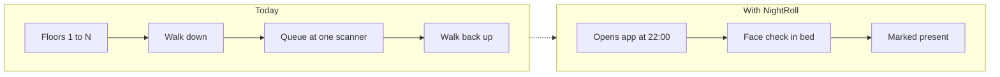

---

## Tech stack

Everything below is in the repository today. Items marked **planned** are not built yet.

**Mobile app (`app/`)**


| Layer | Technology | Used for |
|---|---|---|
| Framework | Expo SDK 57, React Native 0.86, TypeScript, expo-router | Screens and file-based navigation; EAS builds (development and production profiles) |
| Native code | Kotlin Expo Modules in `app/modules/` | `device-key` (Keystore key), `environment` (VPN, proxy, mock location), `wifi-scanner`, `integrity` (Play Integrity token), `face-detector` (ML Kit) |
| Device trust | Android Keystore (StrongBox or TEE), Google Play Integrity API | Non-exportable P-256 signing key; integrity token bound to each payload's hash |
| On-device face checks | ML Kit Face Detection | Face present and steady, and the blink, turn and smile challenge |
| Camera | react-native-vision-camera 5 (on Nitro Modules) | Front-camera frames for enrollment and marking |
| Local storage | expo-secure-store (identity), AsyncStorage (last status) | Student identity stays in secure storage; non-sensitive status is kept for offline use |
| Hashing | expo-crypto | SHA-256 of frames and of the signed payload |
| UI | react-native-reanimated, expo-linear-gradient, expo-font with `@expo-google-fonts` (Fraunces, Hanken Grotesk, JetBrains Mono) | The night theme and the room-window animation |
| Tooling | ESLint (`expo lint`), Prettier, TypeScript | Lint, format and type checks |

**Backend API (`backend/`)**


| Layer | Technology | Used for |
|---|---|---|
| Language and tooling | Python 3.12, managed with uv, ruff | Lockfile installs; lint and format |
| API | FastAPI, uvicorn, Pydantic, pydantic-settings | Typed routes; unknown fields rejected; settings checked at startup (refuses unsafe values outside local) |
| Database access | asyncpg with hand-written, parameterised SQL | No ORM; statement cache off so the pooled connection works |
| Live state | redis-py (asyncio) to Upstash Redis over TLS, Lua scripts | Nonces (single atomic consume), window state, idempotent results, rate limits |
| Scheduler | APScheduler, in its own process (`python -m app.scheduler`) | Opens and closes windows on the server clock; safe to restart |
| Device auth | cryptography (ECDSA P-256), hashlib | Signed student requests and payload signatures |
| Warden auth | PyJWT | Verifies Supabase sign-in tokens, role and MFA; signs the Google service-account assertion |
| Outbound calls | httpx | Google Play Integrity decode and token exchange; face worker |
| Errors and logs | One error shape everywhere, JSON logs with redaction, request IDs | No secrets, tokens or biometrics in logs |
| Tests | pytest, pytest-asyncio | Verification suite against the live database and Redis, Google mocked |

**Face worker (`face/`, internal)**

| Layer | Technology | Used for |
|---|---|---|
| API | FastAPI, uvicorn | Internal endpoints behind a service token |
| Face model | InsightFace `buffalo_l`: SCRFD detection (`det_10g`), landmarks, ArcFace 512-d embeddings (`w600k_r50`) | Detection, alignment and embeddings |
| Inference | ONNX Runtime (CPU), OpenCV (headless), NumPy | Runs the models without a GPU |
| Anti-spoof | Silent-Face MiniFASNetV2, converted to ONNX | Real face versus printed photo or screen |
| Storage | Supabase Storage REST API (via httpx) | Private frames bucket, deleted after 24 hours |
| Model integrity | SHA-256 checksums (`scripts/download_models.py`) | Refuses model files that do not match |

**Data and identity**

| Technology | Used for |
|---|---|
| Supabase PostgreSQL with pgvector | Students, rooms, access points, devices, 512-d embeddings (`extensions.vector`), attendance marks, audit log. Row-level security on every table, with no public policies |
| Supabase Auth | Warden and admin sign-in with a TOTP second factor; the role lives in `app_metadata` |
| Supabase Storage | Private `frames` bucket, never public |
| Supabase CLI | Versioned migrations in `supabase/migrations/`, applied with `supabase db push` |
| Upstash Redis | Nonces, window state, submission results, rate limits and the scheduler heartbeat |

**Warden dashboard (`dashboard/`)**


| Layer | Technology | Used for |
|---|---|---|
| UI and build | React 19, TypeScript, Vite 8 | Dashboard and landing page |
| Routing | react-router 8 | Landing, sign-in and dashboard routes |
| Data layer | TanStack Query | Set up for the live API (wired in Phase 10) |
| Sign-in | @supabase/supabase-js | Warden sign-in only; attendance data always goes through the API |
| Scrolling | Lenis | Smooth scrolling on the landing page |
| Fonts | `@fontsource-variable` (Fraunces, Hanken Grotesk, JetBrains Mono) | Self-hosted, no external font requests |
| Lint | oxlint | Lint |
| Live updates | WebSocket (**planned**, Phase 10) | Live room tiles |

**Infrastructure and external services**

| Technology | Used for |
|---|---|
| Google Play Integrity API | Checks the app and device on every mark |
| Docker Compose (`infra/`) | Placeholder now; Phase 12 adds the API, scheduler, face worker and nginx |
| nginx (**planned**, Phase 12) | TLS and reverse proxy |
| GitHub | Source control; one conventional commit per piece of work |

**Not used:** TensorFlow Lite (ML Kit is used on the phone instead), Celery (the scheduler is APScheduler), and any push service (students open the app themselves).

## System architecture

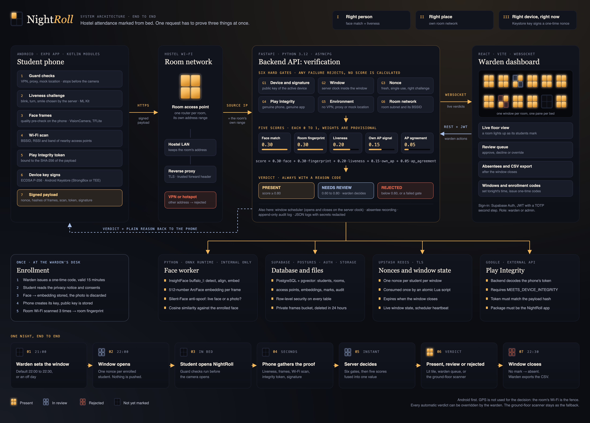

Four zones: the phone gathers evidence, the hostel network vouches for location, the backend decides, and the outputs inform the student and the warden.

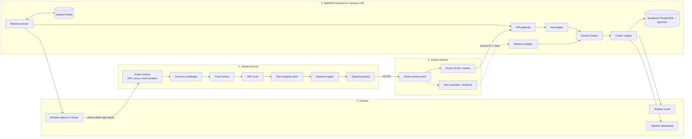

### Backend components

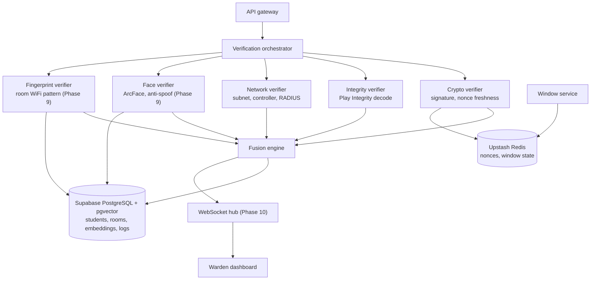

---

## Verification pipeline

Every submission goes through the same steps in order. The first failure decides the outcome, and no face is compared before the gates pass.

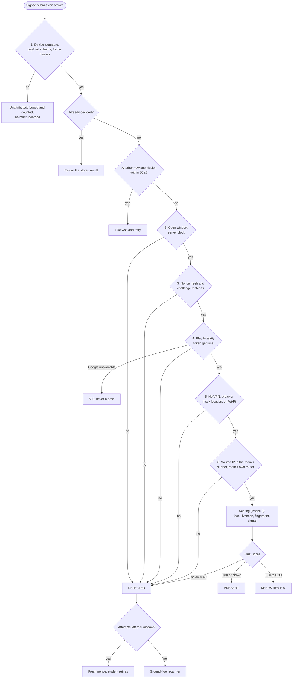

| # | Gate | Defeats |
|---|---|---|
| 1 | Device signature over the raw payload bytes, then schema, version and frame hashes | A friend's phone, editing after signing, swapped photos |
| 2 | Open window and server clock. The phone's clock is recorded, never trusted | Changing the phone's time, marking outside the window |
| 3 | Fresh, single-use nonce, with the challenge checked before it is used | Replaying an old request, a recorded video of the challenge |
| 4 | Play Integrity: right app, bound to this payload, device integrity met | Rooted phones, emulators, repackaged apps |
| 5 | No VPN, proxy or mock location; connected to Wi-Fi | Tunnelling and fake locations |
| 6 | Source IP inside the room's subnet, and the router is one of the room's | Marking from another room or from outside the hostel |

Rules that apply across the gates:

- A repeat of an identical submission gets the same stored result, and no second mark is written.
- A student has three attempts per window. After a rejection the server issues a fresh nonce; after the third, the student is sent to the ground-floor scanner.
- Google being unreachable returns a 503. A mark never passes because a check could not run.
- A forwarded-for address is believed only when the connection comes from a listed trusted proxy.

> [!NOTE]
> Scoring is Phase 9. Until it lands, a submission that passes all six gates is recorded as **NEEDS REVIEW** with the reason `SCORING_PENDING`.

## One night, end to end

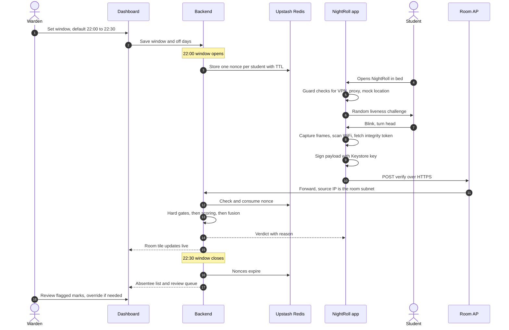

### Attendance states

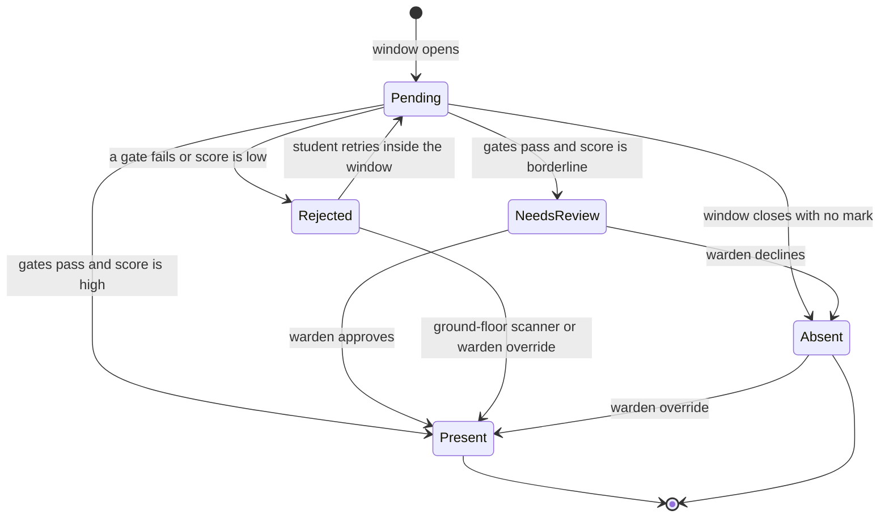

---

## Enrollment

Enrollment happens once, in person, at the warden's office. That is what makes the later remote checks trustworthy.


- **Face:** only the embedding is stored. The enrollment photo is discarded.
- **Device:** the private key is generated inside the phone's secure hardware and never leaves it. A new phone means re-enrolling the device.
- **Room:** one student scans the room; roommates share the same room fingerprint.

---

## Trust score

Marks that pass every gate are scored from five signals.

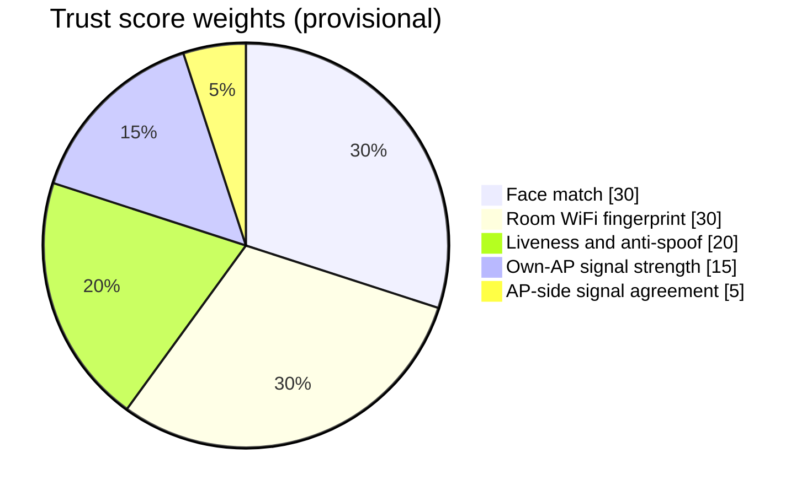

| Signal | Weight | What it measures |
|---|---|---|
| Face match | 0.30 | Cosine similarity between tonight's embedding and the enrolled one |
| Room WiFi fingerprint | 0.30 | How closely tonight's scan matches the room's saved pattern |
| Liveness and anti-spoof | 0.20 | Challenge completed, and the face is not a photo or a screen |
| Own-AP signal strength | 0.15 | The room's own router is seen at room-level strength |
| AP-side signal agreement | 0.05 | The router's view of the phone agrees with the phone's report |

| Score | Verdict | What happens |
|---|---|---|
| 0.80 or above | **PRESENT** | Recorded; room tile turns green |
| 0.60 to 0.80 | **NEEDS REVIEW** | Goes to the warden's review queue |
| Below 0.60 | **REJECTED** | Student sees the reason and can retry or use the ground-floor scanner |

> [!NOTE]
> These weights and cutoffs are starting values. They will be tuned against real measurements from the hostel (see the walk test below) before anyone relies on them.

---

## Geofencing with WiFi

GPS cannot tell one room from the next indoors, and it is easy to fake. NightRoll uses the WiFi itself as the fence.

Every spot in the hostel sees the surrounding routers differently. Inside room 203, the room's own router is very strong, the neighbours are medium, the corridor is weak. Outside the compound wall, most hostel routers vanish and unfamiliar networks appear. That pattern is the room's fingerprint.

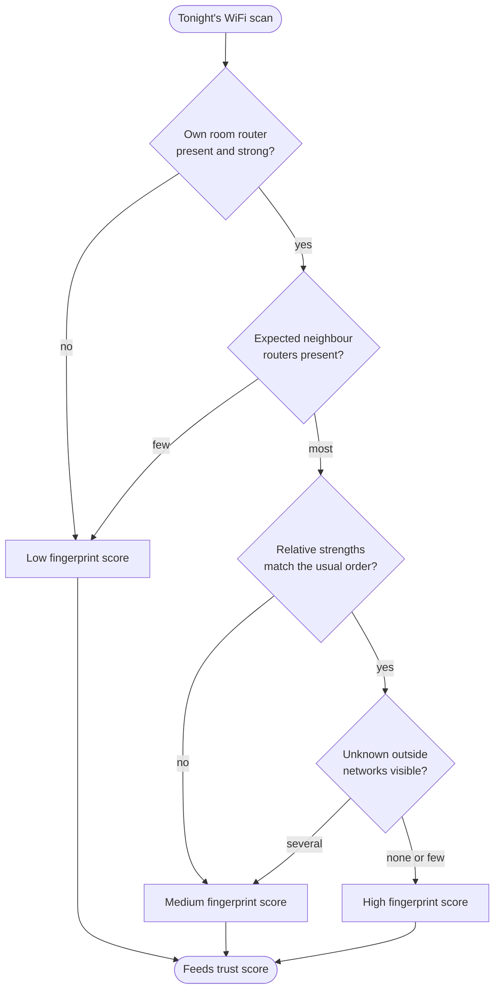

### Calibrating with a walk test

Limits are measured, not guessed.

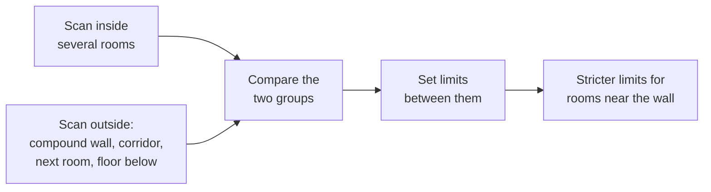

### Keeping fingerprints fresh

- **Slow drift:** confident "present" marks are blended into the saved fingerprint. Borderline marks never are, so a cheater cannot teach the system a wrong pattern.
- **Router replaced:** the warden triggers a re-scan for that room.
- **Stale fingerprint:** repeated reviews from one room flag it on the dashboard.

### Supporting layers

| Layer | Role |
|---|---|
| Router minimum-signal setting | The router drops weak clients, so distant phones cannot stay connected |
| Router-side signal check | A large gap between the router's reading and the phone's report suggests a faked scan |
| 5 GHz signal | Blocked by walls more than 2.4 GHz; used as evidence if the walk test shows it helps, not as a rule |
| GPS | A warning only, and only when accurate and clearly outside the hostel |

---

## Threat model

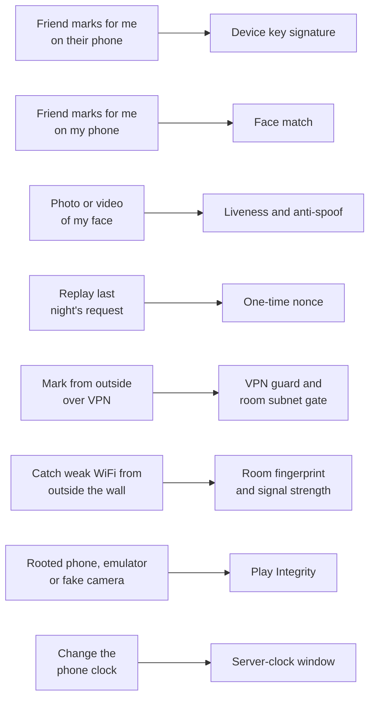

| Limitation | Handling |
|---|---|
| Student marks present, then leaves | Out of scope for the first release; random spot-checks are on the roadmap |
| Phone dead, no WiFi, router down | Ground-floor scanner stays as the fallback |
| iPhones cannot do full WiFi scans | Android first; iPhone users keep the ground-floor scanner |
| Hostel network does not expose subnets or a controller API | Needs the network admin; the design degrades to fingerprint plus review |

---

## Data model

The tables below are the ones created by the migrations in `supabase/migrations/`. Nonces and challenges are not stored in Postgres; they live in Upstash Redis with a TTL that ends when the window closes.

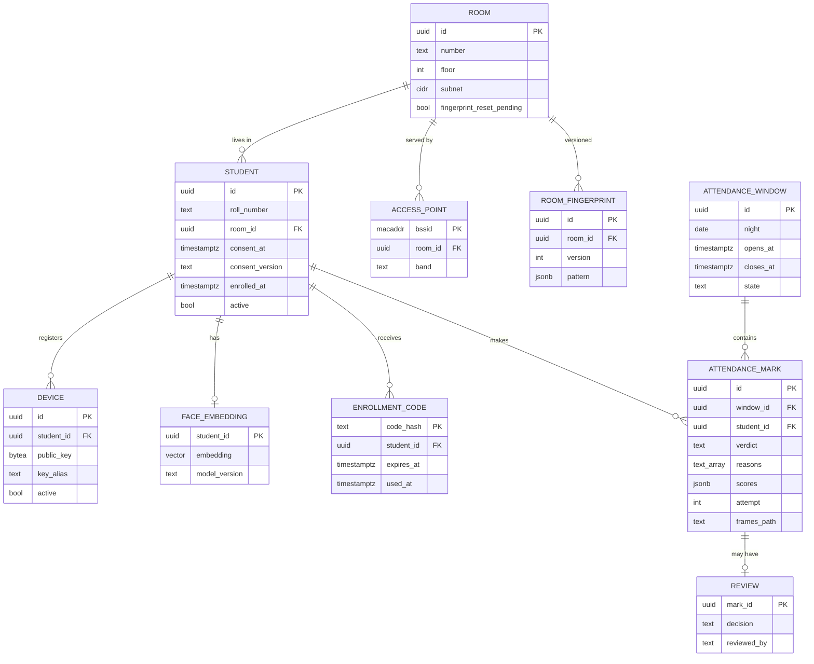

The `audit_log` table is append-only and is not drawn above: every action writes a row to it in the same transaction as the action itself.

## Deployment

The backend sits on the campus LAN so the source IP of every request is the student's real room address.

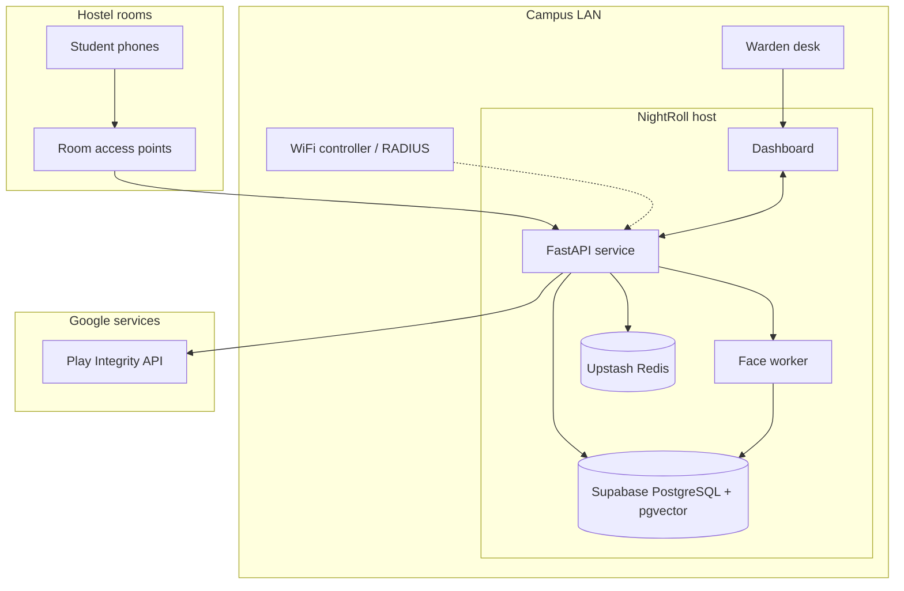

---

## Privacy

Face data is sensitive, so the rules are fixed from the start.

- **Consent first.** Enrollment requires explicit, recorded consent.
- **Embeddings, not photos.** Only the numeric face embedding is stored.
- **Short-lived frames.** Frames captured for a nightly check are deleted within 24 hours.
- **No biometric logging.** Embeddings and raw frames never appear in logs.
- **Reasons shown.** A student always sees why a mark was rejected or sent to review.
- **A human decides the edge cases.** The warden can override any automatic verdict.

---

## Demo plan

Two ordinary routers stand in for Room 101 and Room 102, each on its own subnet.

| # | Action | Expected result |
|---|---|---|
| 1 | Mark from the Room 101 router | **PRESENT**; the tile turns green |
| 2 | Switch to the Room 102 router | **REJECTED** at the room subnet gate |
| 3 | Hold up a photo or a video of the face | **REJECTED** by liveness |
| 4 | Mark from a teammate's phone | **REJECTED**; signature does not match |
| 5 | Walk out of the building while still on WiFi | **REJECTED**; WiFi pattern does not match the room |

Production plugs into the hostel's existing WiFi controller or RADIUS. No new hardware is required.

---

## Roadmap

```mermaid
flowchart LR
    subgraph M1["MVP: hackathon"]
        direction TB
        a1["Signed nonce per student"]
        a2["Room subnet gate"]
        a3["Face match and liveness challenge"]
        a4["Dashboard with room tiles"]
    end
    subgraph M2["Next"]
        direction TB
        b1["WiFi fingerprint and walk test"]
        b2["Passive anti-spoof model"]
        b3["Controller or RADIUS adapter"]
    end
    subgraph M3["Later"]
        direction TB
        c1["Random spot-checks"]
        c2["Anomaly detection"]
        c3["ERP export, iOS support"]
    end
    M1 --> M2 --> M3
```

## Getting started

### Prerequisites

Install these once. The commands are for macOS with Homebrew; Windows and Linux users can use the official installers.

| Tool | Version | Needed for | Install |
|---|---|---|---|
| Git | any recent | Source control | `brew install git` |
| uv | current | Backend and face worker: installs Python 3.12 and the dependencies | `brew install uv` |
| Node.js | 20 LTS (see `app/.nvmrc`) | Dashboard and app | `brew install node@20` |
| JDK | 17 | Android native builds | `brew install openjdk@17` |
| Android Studio | current stable | Android SDK and emulator | developer.android.com/studio |
| Supabase CLI | current stable | Migrations and linking the project | `brew install supabase/tap/supabase` |
| Expo Go | current | Viewing app screens on a phone | Play Store |
| Docker Desktop | current stable | Optional now; needed from Phase 12 | docker.com |

EAS (`npx eas-cli`) runs without installing anything globally.

### First-time setup

1. Clone the repository and check out the branch you are working on:

   ```bash
   git clone https://github.com/Rahul-8283/NightRoll.git
   cd NightRoll
   git checkout <branch>
   ```

2. Create the local environment files from the examples. Ask the team for the real values, and never commit them:

   ```bash
   cp backend/.env.example backend/.env
   cp face/.env.example face/.env
   cp dashboard/.env.example dashboard/.env
   cp app/.env.example app/.env
   cp config/rooms.example.json config/rooms.local.json
   ```

3. Put the Google service account file at `backend/secrets/google-service-account.json`. It comes from the team password manager and is git-ignored.

4. Paste the Upstash `rediss://` URL into `backend/.env` as `REDIS_URL`. Check it with the command under **Running each service**.

5. Link Supabase and apply the migrations. Follow [supabase/README.md](supabase/README.md), then run `supabase db push` from the repository root.

6. Load the demo rooms, students and a warden account:

   ```bash
   cd backend
   uv run python ../scripts/seed.py
   uv run python ../scripts/create_warden.py --email warden@example.com --role warden
   ```

   The script asks for the password; it is never printed or passed on the command line.

### Running each service

| Service | Port | Start with | Status |
|---|---|---|---|
| Upstash Redis | hosted, TLS | Nothing to start; check with the command below | Hosted |
| Supabase | hosted | Nothing to start | Hosted |
| Backend API | 8000 | `cd backend && uv run uvicorn app.main:app --reload --port 8000` | Health, rooms, students, windows, enrollment, nonce and verify endpoints |
| Window scheduler | none | `cd backend && uv run python -m app.scheduler` | Opens and closes windows on the server clock |
| Face worker | 8100 | `cd face && uv sync && uv run python scripts/download_models.py && uv run uvicorn worker.main:app --port 8100` | Embeddings, anti-spoof, frame storage |
| Warden dashboard | 5173 | `cd dashboard && npm install && npm run dev` | Landing and pages; they show sample data while `VITE_SAMPLE_DATA=true` |
| Student app | Metro 8081 | `cd app && npm install && npx expo start` | Screens run in Expo Go; native features need a development build |

Start order once everything is set up: face worker, backend API, scheduler, dashboard, then the phone app.

**Check Redis**

```bash
docker run --rm redis:7 redis-cli --tls -u "<your REDIS_URL>" ping   # expect PONG
```

**Check the backend**

```bash
curl http://localhost:8000/v1/health    # expect {"status":"ok", ...}
```

**Run the tests**

```bash
cd backend
uv run pytest ../tests -q
```

The tests use the live database and Redis, so the services above must be configured first.

**Student app on a phone**

The phone and the laptop must be on the same Wi-Fi. Set `EXPO_PUBLIC_API_BASE_URL` in `app/.env` to the laptop's LAN address, not `10.0.2.2`, which only works in the Android emulator.

```bash
cd app
npx expo start                                               # screens: scan with Expo Go
npx eas-cli build --profile development --platform android   # once: a development build for the phone
npx expo start --dev-client                                  # then open the development build
```

**Anti-spoof model (only if `face/models/antispoof.onnx` is missing)**

```bash
cd face
uv run --with torch==2.14.1 --with onnx==1.23.2 python scripts/convert_antispoof.py
```

### Stopping everything

Press `Ctrl+C` in each terminal. Upstash and Supabase run in the cloud, so there is nothing to stop for them.

## Repository layout

```text
NightRoll/
├── app/          Expo student app; Kotlin native modules in app/modules/
├── backend/      FastAPI service: auth, windows, nonces, enrollment, verification gates
├── face/         Face worker (internal): embeddings, anti-spoof, frame storage
├── dashboard/    React warden dashboard
├── supabase/     Migrations and the Supabase CLI project
├── infra/        Docker Compose (Phase 12 adds the services)
├── config/       Room map example; the real map stays local and git-ignored
├── scripts/      Seed data, warden account, Phase 0 risk spikes
├── tests/        Cross-service test suites
├── docs/         PRD, TRD and architecture
├── phase/        Build plan, one file per phase
└── Images/       Architecture diagram
```

## Project status

Built in the repository so far:

| Phase | Scope | Status |
|---|---|---|
| 0 | Base setup, environment files, folder structure | Done |
| 1 | Data layer: migrations, row-level security, private frames bucket, seed data, warden account | Done |
| 2 | Backend core: settings, connections, warden sign-in, error shape, logs, audit, room and student endpoints | Done |
| 3 | Attendance windows, one-time nonces, scheduler, absentee recording | Done |
| 4 | App foundation, Keystore device key, signed requests, Home screen | Done |
| 5 | Face worker: embeddings, anti-spoof, quality checks, frame storage and cleanup | Done |
| 6 | Enrollment: codes, consent, face and device enrolment, room fingerprint, withdrawal | Done; the phone flow needs a run on a test phone |
| 7 | Nightly capture: guard checks, liveness, frames, Wi-Fi scan, signed payload | Done; needs a development build on a phone to verify |
| 8 | Verification API and six hard gates, idempotency, rate limit, attempt recording | Implemented; test suite passing against live services; not yet merged |
| 9 | Scoring, fingerprint matching, verdicts | Not started |
| 10 | Warden dashboard with live updates | Not started; landing page and sample-data screens are in progress |
| 11 to 13 | Review and override, hardening and deployment, testing and rehearsal | Not started |

**Not yet verified on hardware:** the Keystore key on a real phone, the camera and liveness flow, the Wi-Fi scan, Play Integrity with the real service account, and the anti-spoof model against printed photos and screens. Face thresholds are provisional until they are tuned on the hostel's own enrolment data.

## License

Released under the [Apache License 2.0](LICENSE).
## Team

**Team Zero_Latency**

<table align="center">
  <tr>
    <td align="center" width="25%">
      <a href="https://github.com/Rahul-8283"></a><br>
      <b>Rahul L S</b><br>
      <a href="https://github.com/Rahul-8283">@Rahul-8283</a>
    </td>
    <td align="center" width="25%">
      <a href="https://github.com/djivites"></a><br>
      <b>Jivites</b><br>
      <a href="https://github.com/djivites">@djivites</a>
    </td>
    <td align="center" width="25%">
      <a href="https://github.com/sukanthan06"></a><br>
      <b>Sukanthan</b><br>
      <a href="https://github.com/sukanthan06">@sukanthan06</a>
    </td>
    <td align="center" width="25%">
      <a href="https://github.com/kesavvvvvv"></a><br>
      <b>Kesav Satya Sai Nimmagadda</b><br>
      <a href="https://github.com/kesavvvvvv">@kesavvvvvv</a>
    </td>
  </tr>
</table>
