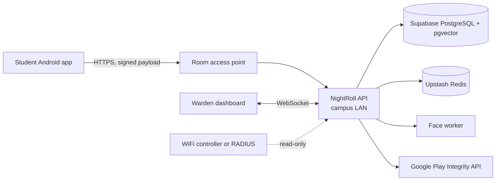
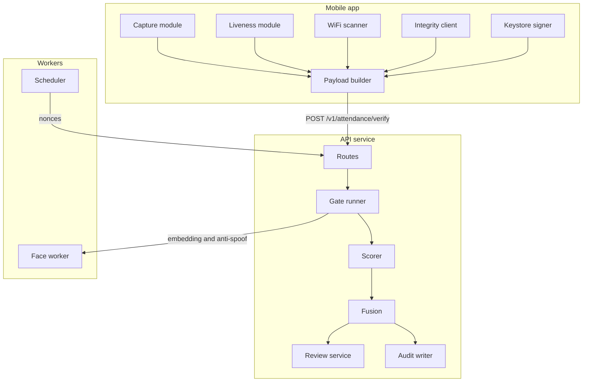
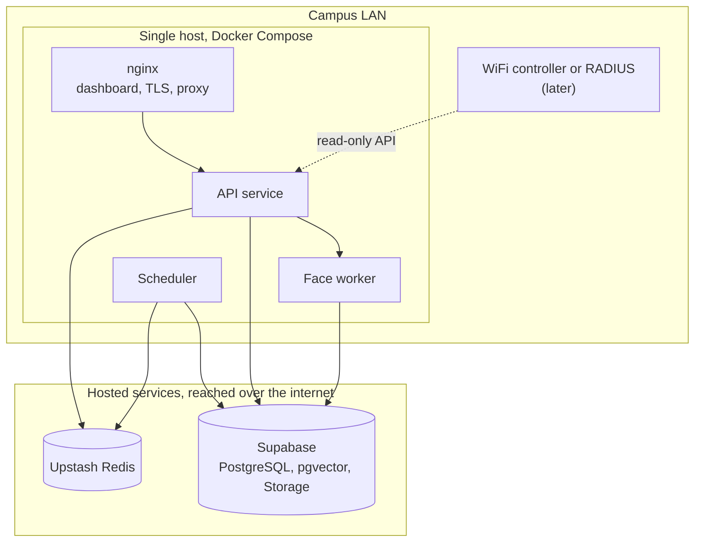

# NightRoll: Technical Requirements Document

**Team:** Zero_Latency
**Event:** Genesis Hackathon
**Status:** Design stage
**Version:** 0.1
**Companion documents:** Product Requirements Document (PRD), README and architecture diagrams

---

## 1. Purpose

This document defines how NightRoll is built: components, interfaces, data, security controls, verification logic, deployment, and quality targets. The PRD explains why and for whom. This document explains how.

Values marked **provisional** are starting points to be confirmed by measurement in the hostel.

---

## 2. Scope

**In scope (first release)**
- Android app with enrollment, nightly marking, and fallback messaging
- Backend API with window management, enrollment, verification, and review
- Face embedding and liveness/anti-spoof service
- WiFi scan capture and room fingerprint matching
- Warden dashboard with live room status over WebSocket
- Window status on the student app's Home screen, fetched when the app opens (no push service)
- Audit log and CSV export

**Out of scope**
- iOS client
- Random spot-checks
- Anomaly detection
- ERP integration
- Automatic fingerprint learning

---

## 3. System context



**External dependencies:** Google Play Integrity API, and the hostel WiFi controller or RADIUS (optional until confirmed).

---

## 4. Architecture

### 4.1 Components

| Component | Responsibility | Technology | Deployed as |
|---|---|---|---|
| Mobile app | Enrollment, liveness UI, face capture, WiFi scan, signing | Expo (React Native, TypeScript), Expo Modules in Kotlin, VisionCamera, ML Kit, TFLite | Development and production builds via EAS; Expo Go for screens only |
| API service | Hard gates, orchestration, scoring, fusion, window and review logic | FastAPI on Python 3.12 | Container |
| Face worker | Embedding extraction, anti-spoof scoring | InsightFace buffalo_l on ONNX Runtime, Silent-Face | Container, separate from API |
| Scheduler | Opens and closes windows, issues nonces, runs housekeeping | APScheduler, in its own process | Container, same image as the API |
| Network adapter | Judges where the phone is: the room subnet today, a controller or RADIUS later | Python module behind the `NetworkVerifier` interface (`docs/network-adapter.md`) | Inside the API; subnet mode built, controller and RADIUS are contract only |
| Dashboard | Room tiles, review queue, exports | React, WebSocket | Static build behind the gateway |
| Database | Relational data and vector search | Supabase PostgreSQL with pgvector | Hosted, managed by Supabase |
| Auth | Warden and admin login, MFA, JWT issuance | Supabase Auth | Hosted, managed by Supabase |
| Frame storage | Private bucket for short-lived frames | Supabase Storage | Hosted, managed by Supabase |
| Cache and nonce store | Nonces, window state, rate limits | Upstash Redis (hosted, TLS) | Managed by Upstash |

### 4.2 Component interactions



---

## 5. Interfaces

### 5.1 Public API

Base path `/v1`, JSON over HTTPS. Enrollment and verification are called by the student app, authenticated by device signature. All other endpoints require a Supabase Auth access token (JWT) for a warden or admin account.

| Method | Path | Caller | Purpose |
|---|---|---|---|
| GET | `/health` | Anyone | Database, Redis and scheduler status |
| GET | `/metrics` | Admin, or the internal network reaching the API directly | Prometheus text (section 13) |
| GET | `/windows`, `/windows/current`, `/windows/history` | Warden | Windows, tonight's window, past nights |
| POST | `/windows` | Warden | Create or update a window for a night |
| POST | `/windows/{id}/off`, `/open-now`, `/close-now` | Warden | Mark a night off, or open or close a window by hand |
| POST | `/enrollment-codes` | Warden | Issue a 15-minute, single-use enrollment code for a student |
| POST | `/enrollments` | Student app | Submit the code, consent, face frames and device public key |
| GET | `/attendance/nonce` | Student app (device signature) | Window status, and the nonce and challenge when open |
| POST | `/attendance/verify` | Student app (device signature in the body) | Submit the signed marking envelope (section 6.2.1) |
| GET | `/attendance/tonight`, `/attendance/absentees` | Warden | Room counts and the absentee list |
| GET | `/reviews`, `/attendance/marks/{id}` | Warden | The review queue, and one attempt with its scores |
| POST | `/attendance/marks/{id}/review`, `/override` | Warden | Approve or decline a review, or override a decision |
| POST | `/attendance/manual` | Warden | Record a manual mark with a reason |
| POST | `/attendance/marks/{id}/frames/view` | Warden | Signed, 60-second links to a mark's retained frames |
| GET | `/rooms`, `/rooms/{id}`, `/rooms/{id}/tonight` | Warden | Rooms and their state tonight |
| GET, POST | `/rooms/{id}/fingerprint`, `/fingerprint/reset` | Warden | Read, capture or reset a room's Wi-Fi fingerprint |
| GET, PATCH, POST | `/students`, `/students/{id}/enrollment`, `/room`, `/withdraw` | Warden | Roster, enrollment status, room change, consent withdrawal |
| GET | `/exports/attendance` | Warden | CSV export by date range, floor, or room |
| GET | `/audit` | Admin | The audit trail |
| GET | `/alerts` | Warden | The alerts shown as a banner (section 13) |
| GET | `/system` | Admin | Service health, tonight's counts, latency, housekeeping |
| WS | `/ws/rooms` | Warden dashboard | Live room status stream; the first message carries the access token |

### 5.2 Verification request

The marking request is the multipart envelope in section 6.2.1: the signed `payload`, its `signature`, the Play Integrity token and the camera frames. Everything the server decides on is inside the signed payload, and each frame's SHA-256 in it must match the frame that was uploaded. A field the phone did not sign never reaches the decision.

### 5.3 Verification response

```json
{
  "mark_id": "uuid",
  "verdict": "PRESENT | NEEDS_REVIEW | REJECTED",
  "score": 0.87,
  "reasons": [{"code": "WIFI_PATTERN_MISMATCH", "message": "WiFi pattern does not match this room"}],
  "retry_allowed": true,
  "attempts_left": 2,
  "fallback": "GROUND_FLOOR_SCANNER | NONE"
}
```

Reason codes come from a fixed set (section 6.4). Messages are for display only.

### 5.4 Errors

| HTTP | When | Behaviour |
|---|---|---|
| 200 | A gate rejects the mark, or a PRESENT mark already exists, or the same submission is repeated | Body has the verdict and a reason, so the app can show it. A repeat returns the stored answer. |
| 401 | Missing or invalid access token or device signature | Generic message |
| 403 | The account has no warden or admin role, or MFA is not complete | Generic message |
| 409 | The same submission is still being checked, or a review or manual mark conflicts with an earlier one | Error code says which |
| 413 | Payload over 64 KiB, or a frame over 1 MiB | Error code says which |
| 422 | Schema validation fails | Field-level errors |
| 429 | Rate limit exceeded (section 11) | `Retry-After` header, in seconds |
| 503 | Face worker, Play Integrity or the network source unavailable | App shows the ground-floor fallback. Never a pass. |

### 5.5 WebSocket messages

```json
{"type": "room_update", "room_id": "uuid", "present": 3, "total": 4, "pending_review": 1, "updated_at": "RFC 3339"}
```

On reconnect, the client receives a full snapshot. Clients reconnect with exponential backoff.

### 5.6 Window status

No messages are pushed to phones. The student app calls `GET /v1/attendance/nonce` when it opens and every 60 seconds while Home is visible. The response is one of:

- `open`: window ID, closing time, nonce and liveness challenge
- `scheduled`: next opening time
- `marked`: the student already has a present mark
- `off` or `closed`: no marking tonight

---

## 6. Core logic

### 6.1 Window lifecycle

1. Warden creates a window with `opens_at` and `closes_at`.
2. At `opens_at`, the scheduler creates one nonce per active enrolled student in Redis, with TTL equal to `closes_at - now`.
3. At `closes_at`, nonces expire. The scheduler records ABSENT for every student without a PRESENT mark and sends the absentee list to the dashboard.

**Nonce key:** `nonce:{window_id}:{student_id}`, value `{value, used}`. Consumption uses an atomic Lua script that checks the nonce is unused, marks it used, and returns the result. This prevents double use under concurrent requests.

### 6.2 Hard gates

Gates run in this order. The first failure ends the request.

1. **Signature:** ECDSA P-256 verification over the exact UTF-8 bytes of `payload` received in the multipart submission, using the active device public key for the student. The phone signs an exact string of bytes and sends that same string. The server verifies the signature over the bytes it received, and only then reads them as JSON, checks the schema and version, and checks each frame's SHA-256 against the signed hashes. Nothing in the payload is believed before this gate passes, so it runs first.
2. **Window:** `opens_at <= server_now <= closes_at`, and the signed window is the open one. Server time only; the phone's `client_time` is recorded and never used.
3. **Nonce:** exists, unused, belongs to this student, and was issued with the same challenge the payload reports. It is consumed only after the signature check has passed (it always has by now), and the challenge is compared before it is consumed, so a wrong challenge does not burn it.
4. **Integrity:** decode the Play Integrity token through the Google API. Require `MEETS_DEVICE_INTEGRITY`. Require the token's request hash to equal the SHA-256 of the raw payload bytes, which binds the token to this request.
5. **Environment:** VPN, proxy, and mock location all false. These are client reports, so they count as supporting evidence. Play Integrity and the network gate are the independent checks.
6. **Network:** the address is read from the connection, or from the forwarded-for header only when the connection comes from a listed reverse proxy (`TRUSTED_PROXY_IPS`), taking the last entry the proxy wrote, which nginx sets from the address it saw and never from the client.
   - Subnet mode (demo and first pilot): the source address is inside the room's subnet, and the access point the phone reports is one of the room's.
   - Controller and RADIUS modes: the network reports the device on one of the room's access points within the last 120 seconds. Contract only; see `docs/network-adapter.md`.

A failed signature is counted against the caller's address (section 11), and a gate that cannot be judged because Google, the face worker or the network source is unreachable answers 503, never a pass.

### 6.2.1 Submission Envelope and Multipart Format

Nightly attendance is submitted via `POST /v1/attendance/verify` as `multipart/form-data`:

| Part | Content |
|---|---|
| `payload` | The exact UTF-8 string serialized once on the phone |
| `signature` | Base64 DER ECDSA P-256 signature over the payload bytes |
| `integrity_token` | Play Integrity token bound to SHA-256(`payload`), or empty |
| `integrity_error` | Error code if Play Integrity token request failed (optional) |
| `frame_0` to `frame_4` | One to five JPEG frames, each at most 1 MiB (the example below uses four: action 1, action 2, neutral 1, neutral 2) |

**Core Payload schema:**

```json
{
  "v": 1,
  "student_id": "uuid",
  "window_id": "uuid",
  "nonce": "base64url",
  "client_time": "2026-10-10T22:01:14+05:30",
  "challenge": [
    {"action": "blink", "started_ms": 0, "detected_ms": 1180},
    {"action": "turn_right", "started_ms": 1400, "detected_ms": 2950}
  ],
  "frames": [
    {"index": 0, "sha256": "hex", "tag": "blink"},
    {"index": 1, "sha256": "hex", "tag": "turn_right"},
    {"index": 2, "sha256": "hex", "tag": "neutral"},
    {"index": 3, "sha256": "hex", "tag": "neutral"}
  ],
  "wifi": {
    "connected": {"bssid": "aa:bb:cc:00:01:05", "rssi": -52, "band": "5GHz"},
    "scan_age_ms": 800,
    "scan": [
      {"bssid": "aa:bb:cc:00:01:05", "rssi": -52, "band": "5GHz"},
      {"bssid": "aa:bb:cc:00:02:05", "rssi": -71, "band": "5GHz"}
    ]
  },
  "environment": {
    "vpn": false, "proxy": false, "mock_location": false,
    "developer_options": false, "on_wifi": true
  },
  "app_version": "0.1.0"
}
```

### 6.3 Scorers

Scorers run only after all gates pass. Each returns a value in [0, 1] and a reason code.

| Scorer | Input | Method | Provisional rule |
|---|---|---|---|
| Face match | Frame embeddings | Best cosine similarity to the enrolled embedding | Similarity 0.45 maps to 0.0, 0.50 maps to 1.0, linear between |
| Liveness | Challenge result, anti-spoof score per frame | Challenge completed and median anti-spoof score above 0.9 | 1.0 if both pass, else 0.0 |
| Room fingerprint | WiFi scan | Section 6.5 | Match score |
| Own access point | RSSI of own-room BSSID | Linear from -75 dBm (0.0) to -55 dBm (1.0) | Threshold -65 dBm |
| Access point agreement | Controller or RADIUS RSSI and phone RSSI | 1 minus normalised difference, floored at 0 | Full score within 10 dB |

If the controller adapter is unavailable, this score is 0.5 and the reason `AP_UNAVAILABLE` is recorded. It does not reject the mark.

### 6.4 Fusion and verdict

```
score = 0.30*face + 0.30*fingerprint + 0.20*liveness + 0.15*own_ap + 0.05*ap_agreement
```

| Score | Verdict |
|---|---|
| 0.80 or higher | PRESENT |
| 0.60 to below 0.80 | NEEDS_REVIEW |
| Below 0.60 | REJECTED |

Two floors run before the cutoffs, because a strong Wi-Fi match must not carry a face that does not match:

- A face score of 0 is REJECTED with `FACE_MISMATCH`, whatever the total.
- A liveness score of 0 is REJECTED with `LIVENESS_FAILED`, whatever the total.
- A score at or above the PRESENT cutoff in a room with no learned Wi-Fi fingerprint is capped at NEEDS_REVIEW (`FINGERPRINT_MISSING`), because the Wi-Fi signals cannot confirm the room.

Weights and thresholds are read from configuration, so they can be tuned without a release.

**Reason codes (fixed set):** `OUTSIDE_WINDOW`, `NONCE_INVALID`, `SIGNATURE_INVALID`, `DEVICE_NOT_ENROLLED`, `INTEGRITY_FAILED`, `ENVIRONMENT_FLAGGED`, `NETWORK_MISMATCH`, `PAYLOAD_INVALID`, `FACE_MISMATCH`, `LIVENESS_FAILED`, `FINGERPRINT_MISSING`, `WIFI_PATTERN_MISMATCH`, `AP_UNAVAILABLE`, `LOW_SCORE`.

### 6.5 Room fingerprint matching

**Stored per room:** a map of `bssid -> {median_rssi, band, seen_count}` from enrollment scans, the expected neighbour BSSIDs, and the own-room BSSID.

**Checks against tonight's scan:**
- `own_present`: own-room BSSID is visible. If not, the fingerprint score is 0.
- `neighbour_ratio`: fraction of expected neighbours visible, scaled from 0.3 (score 0) to 0.7 (score 1).
- `rank_agreement`: Spearman rank correlation of RSSI over shared BSSIDs, compared with the stored medians.
- `unknown_penalty`: 0.1 for each BSSID that is neither stored nor on the known-outside list, beyond the first two, capped at 0.5.

```
fingerprint = own_present * clamp(0.4*neighbour_ratio + 0.4*rank_agreement + 0.2*(1 - unknown_penalty), 0, 1)
```

All constants here are **provisional** and are set by the walk test.

### 6.6 Fingerprint maintenance

- Enrollment stores version 1.
- A warden re-scan creates a new version. Old versions are kept.
- Automatic blending is out of scope for the first release.
- If more than 30% of a room's marks are NEEDS_REVIEW in a week, the dashboard flags the room for re-scan.

---

## 7. Data

### 7.1 Schema (PostgreSQL)

```sql
CREATE TABLE rooms (
  id uuid PRIMARY KEY,
  number text NOT NULL UNIQUE,
  floor int NOT NULL,
  subnet cidr,
  fingerprint_reset_pending boolean NOT NULL DEFAULT false,
  created_at timestamptz NOT NULL DEFAULT now()
);

CREATE TABLE access_points (
  bssid macaddr PRIMARY KEY,
  room_id uuid REFERENCES rooms(id),
  band text CHECK (band IN ('2.4GHz', '5GHz'))
);

CREATE TABLE students (
  id uuid PRIMARY KEY,
  roll_number text NOT NULL UNIQUE,
  name text NOT NULL,
  room_id uuid NOT NULL REFERENCES rooms(id),
  consent_at timestamptz,
  consent_version text,
  enrolled_at timestamptz,
  active boolean NOT NULL DEFAULT true
);

CREATE TABLE face_embeddings (
  student_id uuid PRIMARY KEY REFERENCES students(id),
  embedding vector(512) NOT NULL,
  model_version text NOT NULL,
  created_at timestamptz NOT NULL DEFAULT now()
);

CREATE TABLE devices (
  id uuid PRIMARY KEY,
  student_id uuid NOT NULL REFERENCES students(id),
  public_key bytea NOT NULL,
  key_alias text NOT NULL,
  active boolean NOT NULL DEFAULT true,
  enrolled_at timestamptz NOT NULL DEFAULT now()
);

-- A student has at most one active device at a time.
CREATE UNIQUE INDEX one_active_device ON devices (student_id) WHERE active;

-- One-time codes a warden issues so a student can enroll a device.
-- The code itself is never stored, only its SHA-256 hash.
CREATE TABLE enrollment_codes (
  code_hash text PRIMARY KEY,
  student_id uuid REFERENCES students(id),
  created_by uuid,
  expires_at timestamptz NOT NULL,
  used_at timestamptz
);

CREATE TABLE room_fingerprints (
  id uuid PRIMARY KEY,
  room_id uuid NOT NULL REFERENCES rooms(id),
  version int NOT NULL,
  pattern jsonb NOT NULL,
  created_at timestamptz NOT NULL DEFAULT now(),
  UNIQUE (room_id, version)
);

CREATE TABLE attendance_windows (
  id uuid PRIMARY KEY,
  night date NOT NULL UNIQUE,
  opens_at timestamptz NOT NULL,
  closes_at timestamptz NOT NULL,
  off boolean NOT NULL DEFAULT false,
  state text NOT NULL DEFAULT 'scheduled' CHECK (state IN ('scheduled', 'open', 'closed', 'off')),
  CHECK (closes_at > opens_at)
);

CREATE TABLE attendance_marks (
  id uuid PRIMARY KEY,
  window_id uuid NOT NULL REFERENCES attendance_windows(id),
  student_id uuid NOT NULL REFERENCES students(id),
  verdict text NOT NULL CHECK (verdict IN ('PRESENT', 'NEEDS_REVIEW', 'REJECTED', 'ABSENT', 'MANUAL')),
  score numeric(4,3),
  reasons text[] NOT NULL DEFAULT '{}',
  scores jsonb,
  attempt int NOT NULL DEFAULT 1,
  frames_path text,
  marked_at timestamptz NOT NULL DEFAULT now()
);

-- At most one PRESENT mark per student per window
CREATE UNIQUE INDEX one_present_per_window
  ON attendance_marks (window_id, student_id)
  WHERE verdict = 'PRESENT';

-- Append-only: a mark is never edited. Every decision is a new row, and the latest decision of each kind wins.
CREATE TABLE reviews (
  id bigserial PRIMARY KEY,
  mark_id uuid NOT NULL REFERENCES attendance_marks(id),
  decision text NOT NULL CHECK (decision IN ('APPROVED', 'DECLINED', 'OVERRIDDEN', 'MANUAL')),
  status text CHECK (status IN ('PRESENT', 'ABSENT')),   -- required for OVERRIDDEN
  reviewed_by text NOT NULL,
  note text,
  reviewed_at timestamptz NOT NULL DEFAULT now()
);

CREATE TABLE audit_log (
  id bigserial PRIMARY KEY,
  actor text NOT NULL,
  action text NOT NULL,
  target_id uuid,
  payload jsonb,
  created_at timestamptz NOT NULL DEFAULT now()
);
```

One view, `student_window_status`, decides each student's status in each window (override, then manual mark, automatic present, approved, declined, pending review, absent, off, not marked). Every screen, the export and the room counts read it.

`students.active` and `devices.active` allow revoking access without deleting history. `attendance_marks.attempt` keeps every retry inside a window as its own row, instead of overwriting the previous one. `enrollment_codes` has no foreign key to a warden table; `created_by` is the warden's Supabase user id, checked against Supabase Auth, not a local table.

### 7.2 Redis keys (Upstash)

Hosted on Upstash over TLS, so every connection uses a `rediss://` URL. Upstash supports TTLs and Lua scripts, which the nonce logic relies on. The keys are short-lived; the table lists them.

| Key | Value | TTL |
|---|---|---|
| `nonce:{window_id}:{student_id}` | `{value, used}` | Until `closes_at` |
| `window:{window_id}:state` | `open`, `closed`, or `off` | `closes_at` + 1 day |
| `ratelimit:submit:{student_id}` | Marker, one new submission per 20 seconds | 20 seconds |
| `ratelimit:{name}:{subject}` | Counter for the limits in section 11 | The limit's window |
| `scheduler:heartbeat` | Time the scheduler last checked in | 24 hours |
| `ops:job:{job}` | When a housekeeping job last ran, and what it did | 30 days |
| `submission:{hash}` | The stored answer to a decided submission, for repeats | Until `closes_at` |

### 7.3 Frame storage

- Frames are written to a private Supabase Storage bucket named `frames`, under `frames/{window_id}/{mark_id}/`. Supabase encrypts objects at rest. Bucket policies deny all public access.
- A cleanup job deletes frames older than 24 hours.
- No API returns frames.
- Only the face worker, using a server-side service credential, can read or write the bucket. No student or warden role has bucket access.

### 7.4 Retention

| Data | Retention |
|---|---|
| Face embeddings | Until the student leaves or withdraws consent |
| Frames | 24 hours |
| Attendance marks and reviews | Per hostel policy; default one academic year |
| Audit log | Same as attendance marks |
| Redis keys | Per table 7.2 |

---

## 8. Face and liveness pipeline

- **Enrollment:** the app captures frames in the warden's office. The face worker detects, aligns, and embeds the best frame using InsightFace buffalo_l (512-dimension ArcFace). Only the embedding is saved.
- **Nightly check:** the app's TFLite model pre-checks face presence and quality. The face worker runs detection, anti-spoof on each frame, and embedding. Embeddings from the best frames are compared with the enrolled one.
- **Liveness challenge:** the app picks a random action from a fixed list (blink, turn left, turn right, smile). The challenge ID is in the signed payload. The server does not rely on the app's completion flag alone; frame-level anti-spoof is the independent check.
- **Model versioning:** models are pinned by version and checksum. Each embedding records its `model_version`. Upgrading the model requires re-enrollment or an embedding migration. It is never done silently.

---

## 9. Mobile app

### 9.1 Requirements

- Built with Expo (React Native, TypeScript). Native code is Kotlin in Expo Modules. Phones run a development build or a production build made with EAS. Expo Go is only for screens without native code.
- Android 9 (API 28) or higher. Android 12 or higher recommended for StrongBox.
- Permissions: camera, location (required by Android for WiFi scans), internet.
- Keys are generated in the Keystore, non-exportable, using StrongBox where available and the TEE otherwise.

### 9.2 Behaviour

- The environment check runs before the camera opens. If a VPN, proxy, or mock location is detected, the app states the reason and stops.
- One WiFi scan per marking session, to respect Android's scan throttling.
- The payload is signed only after every capture step succeeds.
- Request timeout is 10 seconds, with one retry using the same nonce. The server returns the existing mark for a repeated request rather than creating a second one.
- No queuing when offline. After a failed retry, the app shows the fallback message.

### 9.3 Local storage

- No face data or photos are stored on the device.
- Only the key alias, student ID, and room ID are kept in app storage.

### 9.4 Signed requests (status and enrollment)

Every app request that acts for a student (status and nonce fetch, enrollment steps) carries three headers, built in `app/src/api/signing.ts`:

| Header | Value |
|---|---|
| `X-Student-Id` | Student UUID |
| `X-Timestamp` | Current time, Unix seconds |
| `X-Signature` | Base64 DER signature over the string below, made with the device's Keystore key |

String to sign, joined with newlines:

```text
<HTTP method>
<path with query>
<X-Timestamp>
<SHA-256 hex of the request body, or of the empty string>
```

The backend rejects a timestamp more than 60 seconds from its own clock. The marking request in section 5.2 has its own stronger envelope; this format is for the lighter-weight status and enrollment calls.

Until Phase 8 wires up signature verification, `backend/app/auth/device.py` is a stub: it reads `X-Student-Id` and trusts it outright, with no check of `X-Timestamp` or `X-Signature`, and only responds when `APP_ENV=local`.

---

## 10. Warden dashboard

- React single-page app, served by the gateway.
- Login: Supabase Auth with email and password, plus TOTP MFA. Sessions are JWTs; access tokens expire after 1 hour and refresh tokens rotate on use.
- Live updates over WebSocket, with 5-second polling as a fallback.
- Views: floor heatmap (one tile per room), review queue with scores and reasons, absentee list, fingerprint status per room, audit log, CSV export.
- Each override writes an audit row before the UI updates.

---

## 11. Security

| Area | Requirement |
|---|---|
| Transport | TLS 1.2 or higher; HSTS on the dashboard |
| Student authentication | Device-bound ECDSA signature on every mark |
| Warden authentication | Supabase Auth, email and password with TOTP MFA |
| Authorisation | Roles `warden`, `admin`, `system`. Only `warden` can override or review. |
| Secrets | Environment or secret manager only. Supabase service role key never reaches the app or dashboard. Never committed to git. |
| Input validation | Strict schema validation; unknown fields rejected |
| Rate limiting | In Redis, per section below. A limited request gets 429 with `Retry-After`. Supabase Auth login limits are set in Supabase. |
| Startup checks | With `APP_ENV` `pilot` or `production` the API refuses to start if Play Integrity enforcement is off, the network check is off, MFA is not required, `TRUSTED_PROXY_IPS` is empty or open, `FACE_WORKER_TOKEN` is under 32 characters, or the face worker reports its anti-spoof model unavailable. `APP_ENV=demo` starts and prints a banner listing each relaxed setting. |
| Edge | nginx terminates TLS, overwrites the forwarded-for header with the address it saw, limits request bodies to what the endpoints accept, and sends HSTS, a content security policy allowing only the API and Supabase, no framing and no MIME sniffing. Release builds of the app trust only the server's own certificate authority. |
| Logging | No embeddings, frames, tokens, or full signatures. Student IDs hashed in application logs. |
| Dependencies | Pinned versions; dependency scanning in CI |
| Backups | Supabase's, by plan (see `docs/runbook.md`); one restore test before pilot |
| Least privilege | Face worker has no access to attendance tables. API has no access to frame storage. Row-level security on every table. Service role key is server-side only. |

### 11.1 Rate limits

Counters live in Redis. A limited request gets `429` with a `Retry-After` header. If Redis cannot be reached a limit is skipped and logged, because the marking path needs Redis anyway and `/v1/health` reports it as degraded.

| Route | Limit | Keyed by |
|---|---|---|
| `POST /v1/attendance/verify` | One new submission per 20 seconds; three rejected attempts per window, after which `retry_allowed` is false | Student |
| `POST /v1/enrollments` | Five failed codes lock code entry for 15 minutes | Student |
| `GET /v1/attendance/nonce` | 10 per minute | Student |
| Any student route failing the signature check | 20 failures per minute, after which the address is refused for the rest of the minute | Client address |
| Warden API | 300 per minute | Warden |
| Export | 10 per hour | Warden |

---

## 12. Deployment

### 12.1 Environments

| Environment | Purpose | Where |
|---|---|---|
| Local | Development | Laptops; services run directly or from `infra/docker-compose.yml`. `APP_ENV=local`. |
| Demo | Hackathon demo | One laptop on a router-backed test network. `APP_ENV=demo`. |
| Pilot | Hostel pilot | One server on the campus LAN. `APP_ENV=pilot`, with the safety checks of section 11 enforced. |

### 12.2 Pilot topology



### 12.3 Containers (pilot sizing)

| Container | Base image | Port | Resources |
|---|---|---|---|
| nginx (also serves the dashboard build) | nginx:1.28-alpine | 80 (redirects) and 443, the only ports published | 0.5 vCPU, 256 MB |
| api | python:3.12-slim-bookworm, dependencies from `uv.lock`, runs as a non-root user | 8000, inside the Compose network only | 2 vCPU, 2 GB |
| face-worker | python:3.12-slim-bookworm with ONNX Runtime, non-root. Models are mounted read-only and checked against their recorded SHA-256 on every start. | 8100, inside the Compose network only | 4 vCPU, 4 GB |
| scheduler | api image, command `python -m app.scheduler` | none | 0.25 vCPU, 256 MB |

There is no database container: the database is Supabase's and Redis is Upstash's. Every container has a health check, `api` waits for `face-worker` to be healthy, all restart `unless-stopped`, and no secret is baked into an image: env files are read when the containers start. nginx has a fixed address on the Compose network, which is what `TRUSTED_PROXY_IPS` is set to.

Sizing assumes 1,000 students marking in a 30-minute window: about 0.6 verifications per second at peak, with face work dominating CPU.

### 12.4 Configuration

Read from environment variables or a config file, never hard-coded. Each service has its own `.env` and a matching `.env.example` that lists every variable the code reads; `infra/.env` holds the few values Compose itself needs:
- Window defaults
- Score weights and verdict thresholds
- Fingerprint constants
- Room and access point map
- Controller or RADIUS endpoint
- Play Integrity package name and API key

Changing these does not require a code change.

---

## 13. Observability

- **Logs:** JSON on standard output from every service, one line per request, each with a timestamp and a request ID. nginx assigns the ID, the API reuses it and passes it to the face worker, so one ID follows a request through all three. The API's lines carry the verdict and reason codes; no personal data beyond a hashed student ID. The face worker logs a route template, never a student's ID.
- **Metrics:** `GET /v1/metrics` in Prometheus text format, for an admin or for a caller on the internal network that reaches the API directly (never through the proxy). Request count and latency per route template, verdicts, gate failures by reason code, time per verification stage, face worker round trips by outcome, open dashboard sockets, and the age of the scheduler heartbeat.
- **System page (admins):** service health, tonight's counts, gate failures by reason, latency, the last run of each housekeeping job, and any relaxed settings.
- **Alerts, as a banner on every dashboard page:** the face worker down while a window is open; the scheduler heartbeat stale (older than 60 seconds); more than 20% of the last five minutes' attempts rejected (needs at least five attempts). Not built: a verification error-rate alert, and a frame-volume alert (frames live in Supabase Storage, not on a volume of ours).
- **Housekeeping:** the scheduler writes its heartbeat every 15 seconds, clears used and expired enrollment codes daily and records room health when a window closes; the face worker deletes frames older than 24 hours, once shortly after it starts and then hourly.

---

## 14. Performance targets

| Measure | Target |
|---|---|
| Verdict latency, p95 | 2 seconds or less, excluding device capture |
| Face worker, per frame | 150 ms or less on pilot hardware |
| Dashboard update after verdict | 2 seconds or less |
| Verifications per second | 5 sustained, 20 burst |

---

## 15. Testing

| Level | What is tested | Tools |
|---|---|---|
| Unit | Each gate, each scorer, fusion, fingerprint matching | pytest |
| Contract | Payload schema, error codes, WebSocket messages | pytest with JSON Schema |
| Integration | Full verify flow with real Redis and PostgreSQL; face worker stubbed | pytest with Testcontainers |
| Face and liveness | Accuracy on labelled enrolled and non-enrolled faces; anti-spoof on printed photos and screen replays | Custom script; results recorded |
| Network gate | Subnet check with two routers; controller adapter against a recorded API response | Manual test plus recorded fixtures |
| Walk test | Fingerprint limits inside and outside the hostel | Manual, documented in `docs/` |
| Load | 20 verifications per second for 60 seconds | k6 or Locust |
| Demo rehearsal | Full five-step demo from section 16 | Manual, timed |

---

## 16. Demo specification

Two routers, each on its own subnet, stand in for Room 101 and Room 102.

| Step | Action | Expected |
|---|---|---|
| 1 | Mark from Room 101 router | PRESENT |
| 2 | Switch to Room 102 router | REJECTED at network gate |
| 3 | Hold up a photo or video of the face | REJECTED by liveness |
| 4 | Mark from a teammate's phone | REJECTED by signature |
| 5 | Walk out while on WiFi | REJECTED by fingerprint |

A pre-recorded backup video of all five steps is kept in case of failure on stage.

---

## 17. Failure modes

| Failure | Behaviour |
|---|---|
| Face worker down | Verification returns 503; app shows fallback; warden sees alert |
| Redis down | Verification returns 503; no nonce can be consumed, so no marks are accepted |
| PostgreSQL down | Verification returns 503; nothing is written |
| Play Integrity unavailable | 503 with fallback; no silent pass |
| Controller or RADIUS unavailable | `AP_UNAVAILABLE` with neutral score; mark continues |
| Student does not open the app | Warden sees who has not marked on the dashboard and can announce the time |
| Router down for a room | Fingerprint fails; students use fallback; warden sees a room alert |
| Clock drift on the server | NTP required; window checks fail closed if the offset exceeds 5 seconds |

The system fails closed for security gates. It never accepts a mark it could not verify.

---

## 18. Migration and rollout

1. Build and test on the demo setup (section 16).
2. Walk test in a single block; set fingerprint and threshold values.
3. Pilot one floor for two weeks, running the ground-floor scanner in parallel. Compare NightRoll verdicts with the scanner and manual checks.
4. Expand to all floors once false rejection and false acceptance rates are measured and accepted by the warden.
5. Retire the ground-floor scanner only after the warden and administration sign off.

---

## 19. Open technical questions

1. Does the hostel provide per-room subnets, controller API access, or RADIUS accounting?
2. Which band do the hostel's access points use for each room?
3. Is a single campus server acceptable for hosting, or must it sit in a managed environment?
4. Who holds the Google service account credentials for Play Integrity, and how are they rotated?
5. Is hosted Supabase (database, auth, storage) acceptable under the college data policy, or must frames and embeddings stay on campus?
6. Does Silent-Face anti-spoof run acceptably on pilot hardware within the latency target?

---

## 20. Risks

| Risk | Impact | Mitigation |
|---|---|---|
| Network signal not available | Network gate cannot run in production | Fingerprint plus warden review as interim; pitch the integration as a next step |
| Anti-spoof too slow on pilot hardware | Latency target missed | Run anti-spoof on the best frame only; benchmark early |
| Thresholds wrong | Wrong verdicts | Provisional; tune from walk test and pilot data |
| Play Integrity rejects some older phones | Students locked out | Fallback to ground-floor scanner; check device list before pilot |
| Single server failure | Attendance stops for the night | Fallback scanner; daily backups; documented restore procedure |