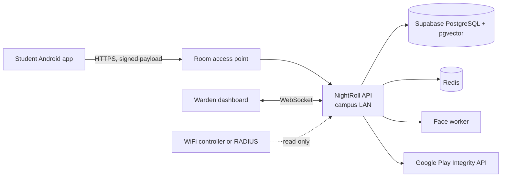
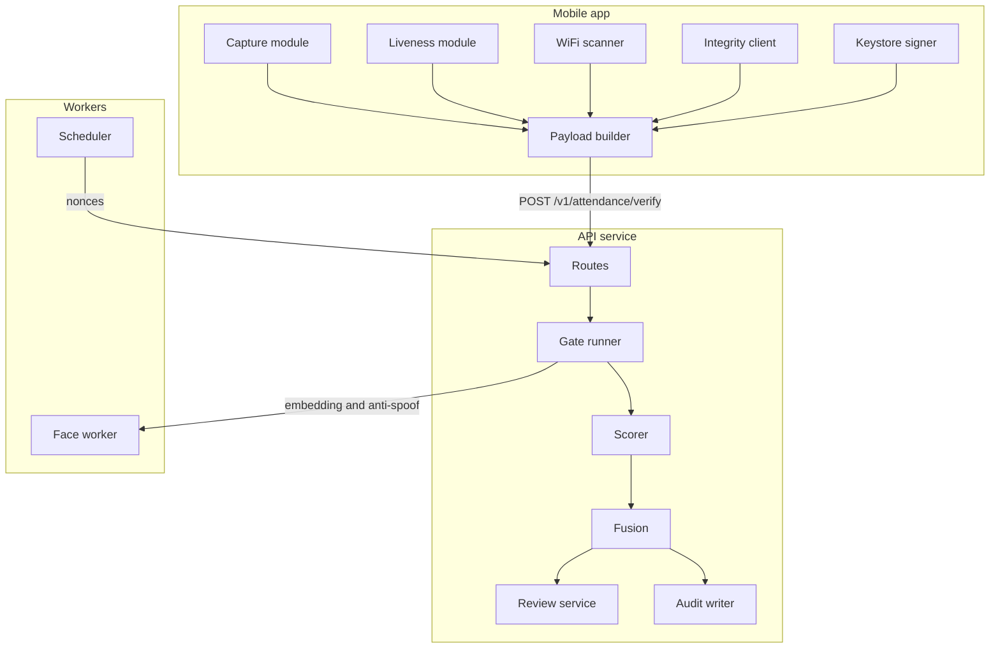
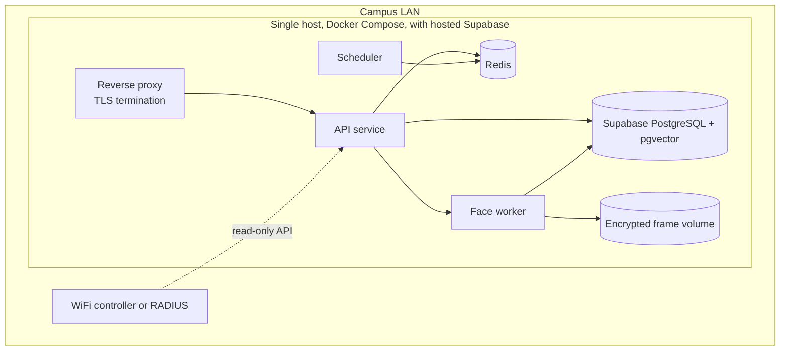

# NightRoll: Technical Requirements Document

**Team:** Zero_Latency
**Event:** Genesis Hackathon
**Status:** Design stage
**Version:** 0.1
**Companion documents:** Product Requirements Document (PRD), README and architecture diagrams

---

## 1. Purpose

This document defines how NightRoll is built: components, interfaces, data, security controls, verification logic, deployment, and quality targets. The PRD explains why and for whom. This document explains how.

Values marked **provisional** are starting points to be confirmed by measurement in the hostel.

---

## 2. Scope

**In scope (first release)**
- Android app with enrollment, nightly marking, and fallback messaging
- Backend API with window management, enrollment, verification, and review
- Face embedding and liveness/anti-spoof service
- WiFi scan capture and room fingerprint matching
- Warden dashboard with live room status over WebSocket
- Window status on the student app's Home screen, fetched when the app opens (no push service)
- Audit log and CSV export

**Out of scope**
- iOS client
- Random spot-checks
- Anomaly detection
- ERP integration
- Automatic fingerprint learning

---

## 3. System context



**External dependencies:** Google Play Integrity API, and the hostel WiFi controller or RADIUS (optional until confirmed).

---

## 4. Architecture

### 4.1 Components

| Component | Responsibility | Technology | Deployed as |
|---|---|---|---|
| Mobile app | Enrollment, liveness UI, face capture, WiFi scan, signing | React Native, VisionCamera, ML Kit, TFLite | Android APK, internal track |
| API service | Hard gates, orchestration, scoring, fusion, window and review logic | FastAPI on Python 3.12 | Container |
| Face worker | Embedding extraction, anti-spoof scoring | InsightFace buffalo_l on ONNX Runtime, Silent-Face | Container, separate from API |
| Scheduler | Opens and closes windows, issues nonces | Celery beat or APScheduler | Container |
| Network adapter | Reads client-to-AP association from controller or RADIUS | Python module behind an interface | Container, optional |
| Dashboard | Room tiles, review queue, exports | React, WebSocket | Static build behind the gateway |
| Database | Relational data and vector search | Supabase PostgreSQL with pgvector | Hosted, managed by Supabase |
| Auth | Warden and admin login, MFA, JWT issuance | Supabase Auth | Hosted, managed by Supabase |
| Frame storage | Private bucket for short-lived frames | Supabase Storage | Hosted, managed by Supabase |
| Cache and nonce store | Nonces, window state, rate limits | Redis 7 | Container |

### 4.2 Component interactions



---

## 5. Interfaces

### 5.1 Public API

Base path `/v1`, JSON over HTTPS. Enrollment and verification are called by the student app, authenticated by device signature. All other endpoints require a Supabase Auth access token (JWT) for a warden or admin account.

| Method | Path | Caller | Purpose |
|---|---|---|---|
| POST | `/windows` | Warden | Create or update a window for a night |
| POST | `/windows/{id}/off` | Warden | Mark a night as off |
| POST | `/enrollments` | Student app | Submit consent, embedding, device public key |
| POST | `/rooms/{room_id}/fingerprint` | Warden or enrollment | Submit room WiFi scans |
| POST | `/attendance/verify` | Student app | Submit signed marking payload |
| GET | `/attendance/{window_id}` | Warden | List marks for a window |
| POST | `/attendance/{mark_id}/review` | Warden | Approve, decline, or override |
| POST | `/attendance/manual` | Warden | Record a manual mark with reason |
| GET | `/exports/attendance` | Administration | CSV export by date range, floor, or room |
| WS | `/ws/rooms` | Warden dashboard | Live room status stream |

### 5.2 Verification request

```json
{
  "student_id": "uuid",
  "window_id": "uuid",
  "nonce": "base64url, 32 bytes",
  "client_time": "RFC 3339, informational only",
  "wifi": {
    "bssid": "aa:bb:cc:dd:ee:ff",
    "ssid_hash": "sha256 of SSID",
    "rssi": -58,
    "band": "5GHz",
    "scan": [{"bssid": "aa:bb:cc:dd:ee:00", "rssi": -61, "band": "2.4GHz"}]
  },
  "frames": [{"sha256": "hex", "liveness_passed": true}],
  "liveness": {"challenge_id": "string", "completed": true, "duration_ms": 4200},
  "integrity_token": "string",
  "environment": {"vpn": false, "proxy": false, "mock_location": false},
  "signature": "base64, ECDSA P-256 over canonical payload"
}
```

Frames are uploaded alongside the request. Each frame's SHA-256 must match the hash in the signed payload.

### 5.3 Verification response

```json
{
  "mark_id": "uuid",
  "verdict": "PRESENT | NEEDS_REVIEW | REJECTED",
  "score": 0.87,
  "reasons": [{"code": "WIFI_PATTERN_MISMATCH", "message": "WiFi pattern does not match this room"}],
  "retry_allowed": true,
  "fallback": "GROUND_FLOOR_SCANNER | NONE"
}
```

Reason codes come from a fixed set (section 6.4). Messages are for display only.

### 5.4 Errors

| HTTP | When | Behaviour |
|---|---|---|
| 200 | Hard gate rejects the mark | Body has verdict REJECTED and a reason, so the app can show it |
| 400 | Schema validation fails | Field-level errors |
| 401 | Missing or invalid access token | Generic message |
| 403 | Device not enrolled, or student not in window | Generic message |
| 409 | Nonce already used, or a PRESENT mark exists for this window | Returns the existing mark ID |
| 429 | Rate limit exceeded | `Retry-After` header |
| 503 | Face worker or Play Integrity unavailable | App shows the ground-floor fallback |

### 5.5 WebSocket messages

```json
{"type": "room_update", "room_id": "uuid", "present": 3, "total": 4, "pending_review": 1, "updated_at": "RFC 3339"}
```

On reconnect, the client receives a full snapshot. Clients reconnect with exponential backoff.

### 5.6 Window status

No messages are pushed to phones. The student app calls `GET /v1/attendance/nonce` when it opens and every 60 seconds while Home is visible. The response is one of:

- `open`: window ID, closing time, nonce and liveness challenge
- `scheduled`: next opening time
- `marked`: the student already has a present mark
- `off` or `closed`: no marking tonight

---

## 6. Core logic

### 6.1 Window lifecycle

1. Warden creates a window with `opens_at` and `closes_at`.
2. At `opens_at`, the scheduler creates one nonce per active enrolled student in Redis, with TTL equal to `closes_at - now`.
3. At `closes_at`, nonces expire. The scheduler records ABSENT for every student without a PRESENT mark and sends the absentee list to the dashboard.

**Nonce key:** `nonce:{window_id}:{student_id}`, value `{value, used}`. Consumption uses an atomic Lua script that checks the nonce is unused, marks it used, and returns the result. This prevents double use under concurrent requests.

### 6.2 Hard gates

Gates run in this order. The first failure ends the request.

1. **Window:** `opens_at <= server_now <= closes_at`. Server time only.
2. **Nonce:** exists, unused, and belongs to this student. It is consumed only after the signature check passes, so a request that fails the signature does not burn the nonce.
3. **Signature:** ECDSA P-256 verification over the canonical JSON of the payload without the `signature` field, using the active device public key for the student. Reject if the device is inactive or not registered.
4. **Integrity:** decode the Play Integrity token through the Google API. Require `MEETS_DEVICE_INTEGRITY`. Require the token's request hash to equal the SHA-256 of the signed payload, which binds the token to this request.
5. **Environment:** VPN, proxy, and mock location all false. These are client reports, so they count as supporting evidence. Play Integrity and the network gate are the independent checks.
6. **Network:**
   - MVP: source IP is inside the room's subnet.
   - Production: the controller or RADIUS reports the device's MAC associated with the room's access point within the last 60 seconds.

### 6.3 Scorers

Scorers run only after all gates pass. Each returns a value in [0, 1] and a reason code.

| Scorer | Input | Method | Provisional rule |
|---|---|---|---|
| Face match | Frame embeddings | Best cosine similarity to the enrolled embedding | Similarity 0.45 maps to 0.0, 0.50 maps to 1.0, linear between |
| Liveness | Challenge result, anti-spoof score per frame | Challenge completed and median anti-spoof score above 0.9 | 1.0 if both pass, else 0.0 |
| Room fingerprint | WiFi scan | Section 6.5 | Match score |
| Own access point | RSSI of own-room BSSID | Linear from -75 dBm (0.0) to -55 dBm (1.0) | Threshold -65 dBm |
| Access point agreement | Controller or RADIUS RSSI and phone RSSI | 1 minus normalised difference, floored at 0 | Full score within 10 dB |

If the controller adapter is unavailable, this score is 0.5 and the reason `AP_UNAVAILABLE` is recorded. It does not reject the mark.

### 6.4 Fusion and verdict

```
score = 0.30*face + 0.30*fingerprint + 0.20*liveness + 0.15*own_ap + 0.05*ap_agreement
```

| Score | Verdict |
|---|---|
| 0.80 or higher | PRESENT |
| 0.60 to below 0.80 | NEEDS_REVIEW |
| Below 0.60 | REJECTED |

Weights and thresholds are read from configuration, so they can be tuned without a release.

**Reason codes (fixed set):** `OUTSIDE_WINDOW`, `NONCE_INVALID`, `SIGNATURE_INVALID`, `DEVICE_NOT_ENROLLED`, `INTEGRITY_FAILED`, `ENVIRONMENT_FLAGGED`, `NETWORK_MISMATCH`, `FACE_MISMATCH`, `LIVENESS_FAILED`, `WIFI_PATTERN_MISMATCH`, `AP_UNAVAILABLE`, `LOW_SCORE`.

### 6.5 Room fingerprint matching

**Stored per room:** a map of `bssid -> {median_rssi, band, seen_count}` from enrollment scans, the expected neighbour BSSIDs, and the own-room BSSID.

**Checks against tonight's scan:**
- `own_present`: own-room BSSID is visible. If not, the fingerprint score is 0.
- `neighbour_ratio`: fraction of expected neighbours visible, scaled from 0.3 (score 0) to 0.7 (score 1).
- `rank_agreement`: Spearman rank correlation of RSSI over shared BSSIDs, compared with the stored medians.
- `unknown_penalty`: 0.1 for each BSSID that is neither stored nor on the known-outside list, beyond the first two, capped at 0.5.

```
fingerprint = own_present * clamp(0.4*neighbour_ratio + 0.4*rank_agreement + 0.2*(1 - unknown_penalty), 0, 1)
```

All constants here are **provisional** and are set by the walk test.

### 6.6 Fingerprint maintenance

- Enrollment stores version 1.
- A warden re-scan creates a new version. Old versions are kept.
- Automatic blending is out of scope for the first release.
- If more than 30% of a room's marks are NEEDS_REVIEW in a week, the dashboard flags the room for re-scan.

---

## 7. Data

### 7.1 Schema (PostgreSQL)

```sql
CREATE TABLE rooms (
  id uuid PRIMARY KEY,
  number text NOT NULL UNIQUE,
  floor int NOT NULL,
  subnet cidr,
  created_at timestamptz NOT NULL DEFAULT now()
);

CREATE TABLE access_points (
  bssid macaddr PRIMARY KEY,
  room_id uuid REFERENCES rooms(id),
  band text CHECK (band IN ('2.4GHz', '5GHz'))
);

CREATE TABLE students (
  id uuid PRIMARY KEY,
  roll_number text NOT NULL UNIQUE,
  name text NOT NULL,
  room_id uuid NOT NULL REFERENCES rooms(id),
  consent_at timestamptz NOT NULL,
  enrolled_at timestamptz,
  active boolean NOT NULL DEFAULT true
);

CREATE TABLE face_embeddings (
  student_id uuid PRIMARY KEY REFERENCES students(id),
  embedding vector(512) NOT NULL,
  model_version text NOT NULL,
  created_at timestamptz NOT NULL DEFAULT now()
);

CREATE TABLE devices (
  id uuid PRIMARY KEY,
  student_id uuid NOT NULL REFERENCES students(id),
  public_key bytea NOT NULL,
  key_alias text NOT NULL,
  active boolean NOT NULL DEFAULT true,
  enrolled_at timestamptz NOT NULL DEFAULT now()
);

CREATE TABLE room_fingerprints (
  id uuid PRIMARY KEY,
  room_id uuid NOT NULL REFERENCES rooms(id),
  version int NOT NULL,
  pattern jsonb NOT NULL,
  created_at timestamptz NOT NULL DEFAULT now(),
  UNIQUE (room_id, version)
);

CREATE TABLE attendance_windows (
  id uuid PRIMARY KEY,
  night date NOT NULL UNIQUE,
  opens_at timestamptz NOT NULL,
  closes_at timestamptz NOT NULL,
  off boolean NOT NULL DEFAULT false,
  CHECK (closes_at > opens_at)
);

CREATE TABLE attendance_marks (
  id uuid PRIMARY KEY,
  window_id uuid NOT NULL REFERENCES attendance_windows(id),
  student_id uuid NOT NULL REFERENCES students(id),
  verdict text NOT NULL CHECK (verdict IN ('PRESENT', 'NEEDS_REVIEW', 'REJECTED', 'ABSENT', 'MANUAL')),
  score numeric(4,3),
  reasons text[] NOT NULL DEFAULT '{}',
  scores jsonb,
  marked_at timestamptz NOT NULL DEFAULT now()
);

-- At most one PRESENT mark per student per window
CREATE UNIQUE INDEX one_present_per_window
  ON attendance_marks (window_id, student_id)
  WHERE verdict = 'PRESENT';

CREATE TABLE reviews (
  mark_id uuid PRIMARY KEY REFERENCES attendance_marks(id),
  decision text NOT NULL CHECK (decision IN ('APPROVED', 'DECLINED', 'OVERRIDDEN')),
  reviewed_by text NOT NULL,
  note text,
  reviewed_at timestamptz NOT NULL DEFAULT now()
);

CREATE TABLE audit_log (
  id bigserial PRIMARY KEY,
  actor text NOT NULL,
  action text NOT NULL,
  target_id uuid,
  payload jsonb,
  created_at timestamptz NOT NULL DEFAULT now()
);
```

`students.active` and `devices.active` allow revoking access without deleting history.

### 7.2 Redis keys

| Key | Value | TTL |
|---|---|---|
| `nonce:{window_id}:{student_id}` | `{value, used}` | Until `closes_at` |
| `window:{window_id}:state` | `open`, `closed`, or `off` | `closes_at` + 1 day |
| `ratelimit:verify:{student_id}` | Counter | 60 seconds |
| `ws:snapshot:{window_id}` | Last room status JSON | `closes_at` + 1 hour |

### 7.3 Frame storage

- Frames are written to a private Supabase Storage bucket named `frames`, under `frames/{window_id}/{mark_id}/`. Supabase encrypts objects at rest. Bucket policies deny all public access.
- A cleanup job deletes frames older than 24 hours.
- No API returns frames.
- Only the face worker, using a server-side service credential, can read or write the bucket. No student or warden role has bucket access.

### 7.4 Retention

| Data | Retention |
|---|---|
| Face embeddings | Until the student leaves or withdraws consent |
| Frames | 24 hours |
| Attendance marks and reviews | Per hostel policy; default one academic year |
| Audit log | Same as attendance marks |
| Redis keys | Per table 7.2 |

---

## 8. Face and liveness pipeline

- **Enrollment:** the app captures frames in the warden's office. The face worker detects, aligns, and embeds the best frame using InsightFace buffalo_l (512-dimension ArcFace). Only the embedding is saved.
- **Nightly check:** the app's TFLite model pre-checks face presence and quality. The face worker runs detection, anti-spoof on each frame, and embedding. Embeddings from the best frames are compared with the enrolled one.
- **Liveness challenge:** the app picks a random action from a fixed list (blink, turn left, turn right, smile). The challenge ID is in the signed payload. The server does not rely on the app's completion flag alone; frame-level anti-spoof is the independent check.
- **Model versioning:** models are pinned by version and checksum. Each embedding records its `model_version`. Upgrading the model requires re-enrollment or an embedding migration. It is never done silently.

---

## 9. Mobile app

### 9.1 Requirements

- Android 9 (API 28) or higher. Android 12 or higher recommended for StrongBox.
- Permissions: camera, location (required by Android for WiFi scans), internet.
- Keys are generated in the Keystore, non-exportable, using StrongBox where available and the TEE otherwise.

### 9.2 Behaviour

- The environment check runs before the camera opens. If a VPN, proxy, or mock location is detected, the app states the reason and stops.
- One WiFi scan per marking session, to respect Android's scan throttling.
- The payload is signed only after every capture step succeeds.
- Request timeout is 10 seconds, with one retry using the same nonce. The server returns the existing mark for a repeated request rather than creating a second one.
- No queuing when offline. After a failed retry, the app shows the fallback message.

### 9.3 Local storage

- No face data or photos are stored on the device.
- Only the key alias, student ID, and room ID are kept in app storage.

---

## 10. Warden dashboard

- React single-page app, served by the gateway.
- Login: Supabase Auth with email and password, plus TOTP MFA. Sessions are JWTs; access tokens expire after 1 hour and refresh tokens rotate on use.
- Live updates over WebSocket, with 5-second polling as a fallback.
- Views: floor heatmap (one tile per room), review queue with scores and reasons, absentee list, fingerprint status per room, audit log, CSV export.
- Each override writes an audit row before the UI updates.

---

## 11. Security

| Area | Requirement |
|---|---|
| Transport | TLS 1.2 or higher; HSTS on the dashboard |
| Student authentication | Device-bound ECDSA signature on every mark |
| Warden authentication | Supabase Auth, email and password with TOTP MFA |
| Authorisation | Roles `warden`, `admin`, `system`. Only `warden` can override or review. |
| Secrets | Environment or secret manager only. Supabase service role key never reaches the app or dashboard. Never committed to git. |
| Input validation | Strict schema validation; unknown fields rejected |
| Rate limiting | One verification per student per 60 seconds; Supabase Auth login limits configured to 5 attempts per 15 minutes |
| Logging | No embeddings, frames, tokens, or full signatures. Student IDs hashed in application logs. |
| Dependencies | Pinned versions; dependency scanning in CI |
| Backups | Daily encrypted database backups; one restore test before pilot |
| Least privilege | Face worker has no access to attendance tables. API has no access to frame storage. Row-level security on every table. Service role key is server-side only. |

---

## 12. Deployment

### 12.1 Environments

| Environment | Purpose | Where |
|---|---|---|
| Local | Development | Laptops, Docker Compose |
| Demo | Hackathon demo | One laptop on a router-backed test network |
| Pilot | Hostel pilot | One server on the campus LAN |

### 12.2 Pilot topology



### 12.3 Containers (pilot sizing)

| Container | Base image | Port | Resources |
|---|---|---|---|
| nginx | nginx:stable | 443 | 0.5 vCPU, 256 MB |
| api | python:3.12-slim | 8000 (internal) | 2 vCPU, 2 GB |
| face-worker | python:3.12 with ONNX Runtime | internal | 4 vCPU, 4 GB |
| scheduler | api image | none | 0.25 vCPU, 256 MB |
| redis | redis:7 | internal | 0.5 vCPU, 512 MB |

Sizing assumes 1,000 students marking in a 30-minute window: about 0.6 verifications per second at peak, with face work dominating CPU.

### 12.4 Configuration

Read from environment variables or a config file, never hard-coded:
- Window defaults
- Score weights and verdict thresholds
- Fingerprint constants
- Room and access point map
- Controller or RADIUS endpoint
- Play Integrity package name and API key

Changing these does not require a code change.

---

## 13. Observability

- **Logs:** structured JSON, one line per request, with request ID, endpoint, verdict, reason codes, and latency. No personal data beyond a hashed student ID.
- **Metrics:** request count and latency per endpoint; verdict counts per window; gate failures by reason code; face worker latency; Redis and PostgreSQL health.
- **Alerts:**
  - Verification error rate above 2% in a window
  - Face worker down while a window is open
  - Frame volume above 80% full
- **Dashboards:** one live view for the warden's night (counts, gate failures, latency) and one for the team (all metrics).

---

## 14. Performance targets

| Measure | Target |
|---|---|
| Verdict latency, p95 | 2 seconds or less, excluding device capture |
| Face worker, per frame | 150 ms or less on pilot hardware |
| Dashboard update after verdict | 2 seconds or less |
| Verifications per second | 5 sustained, 20 burst |

---

## 15. Testing

| Level | What is tested | Tools |
|---|---|---|
| Unit | Each gate, each scorer, fusion, fingerprint matching | pytest |
| Contract | Payload schema, error codes, WebSocket messages | pytest with JSON Schema |
| Integration | Full verify flow with real Redis and PostgreSQL; face worker stubbed | pytest with Testcontainers |
| Face and liveness | Accuracy on labelled enrolled and non-enrolled faces; anti-spoof on printed photos and screen replays | Custom script; results recorded |
| Network gate | Subnet check with two routers; controller adapter against a recorded API response | Manual test plus recorded fixtures |
| Walk test | Fingerprint limits inside and outside the hostel | Manual, documented in `docs/` |
| Load | 20 verifications per second for 60 seconds | k6 or Locust |
| Demo rehearsal | Full five-step demo from section 16 | Manual, timed |

---

## 16. Demo specification

Two routers, each on its own subnet, stand in for Room 101 and Room 102.

| Step | Action | Expected |
|---|---|---|
| 1 | Mark from Room 101 router | PRESENT |
| 2 | Switch to Room 102 router | REJECTED at network gate |
| 3 | Hold up a photo or video of the face | REJECTED by liveness |
| 4 | Mark from a teammate's phone | REJECTED by signature |
| 5 | Walk out while on WiFi | REJECTED by fingerprint |

A pre-recorded backup video of all five steps is kept in case of failure on stage.

---

## 17. Failure modes

| Failure | Behaviour |
|---|---|
| Face worker down | Verification returns 503; app shows fallback; warden sees alert |
| Redis down | Verification returns 503; no nonce can be consumed, so no marks are accepted |
| PostgreSQL down | Verification returns 503; nothing is written |
| Play Integrity unavailable | 503 with fallback; no silent pass |
| Controller or RADIUS unavailable | `AP_UNAVAILABLE` with neutral score; mark continues |
| Student does not open the app | Warden sees who has not marked on the dashboard and can announce the time |
| Router down for a room | Fingerprint fails; students use fallback; warden sees a room alert |
| Clock drift on the server | NTP required; window checks fail closed if the offset exceeds 5 seconds |

The system fails closed for security gates. It never accepts a mark it could not verify.

---

## 18. Migration and rollout

1. Build and test on the demo setup (section 16).
2. Walk test in a single block; set fingerprint and threshold values.
3. Pilot one floor for two weeks, running the ground-floor scanner in parallel. Compare NightRoll verdicts with the scanner and manual checks.
4. Expand to all floors once false rejection and false acceptance rates are measured and accepted by the warden.
5. Retire the ground-floor scanner only after the warden and administration sign off.

---

## 19. Open technical questions

1. Does the hostel provide per-room subnets, controller API access, or RADIUS accounting?
2. Which band do the hostel's access points use for each room?
3. Is a single campus server acceptable for hosting, or must it sit in a managed environment?
4. Who holds the Google service account credentials for Play Integrity, and how are they rotated?
5. Is hosted Supabase (database, auth, storage) acceptable under the college data policy, or must frames and embeddings stay on campus?
6. Does Silent-Face anti-spoof run acceptably on pilot hardware within the latency target?

---

## 20. Risks

| Risk | Impact | Mitigation |
|---|---|---|
| Network signal not available | Network gate cannot run in production | Fingerprint plus warden review as interim; pitch the integration as a next step |
| Anti-spoof too slow on pilot hardware | Latency target missed | Run anti-spoof on the best frame only; benchmark early |
| Thresholds wrong | Wrong verdicts | Provisional; tune from walk test and pilot data |
| Play Integrity rejects some older phones | Students locked out | Fallback to ground-floor scanner; check device list before pilot |
| Single server failure | Attendance stops for the night | Fallback scanner; daily backups; documented restore procedure |