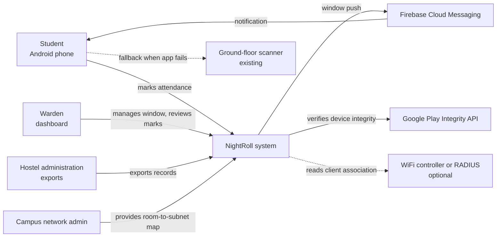
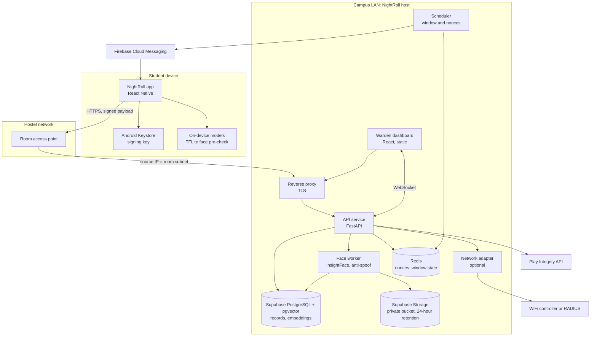
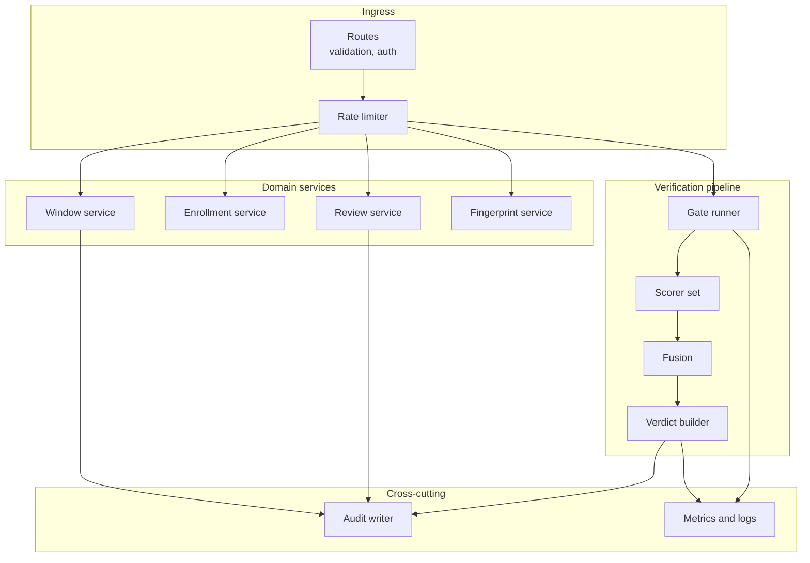
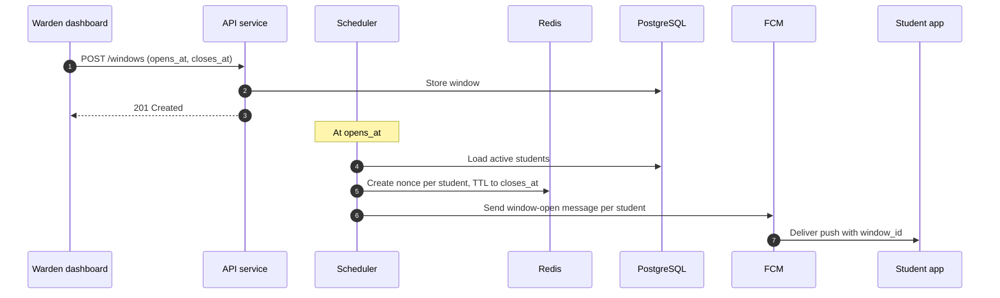
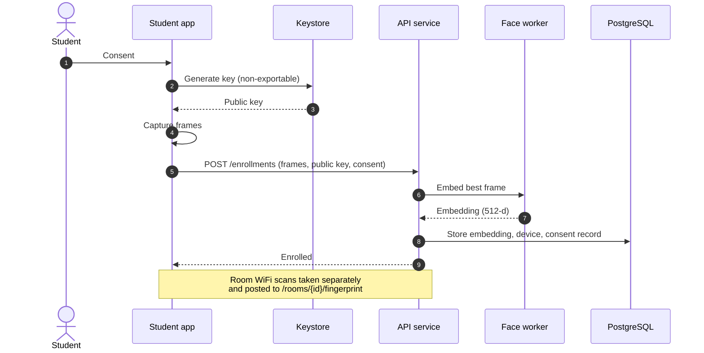
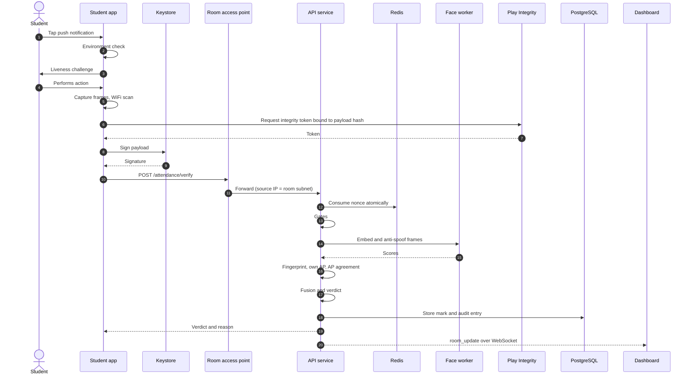
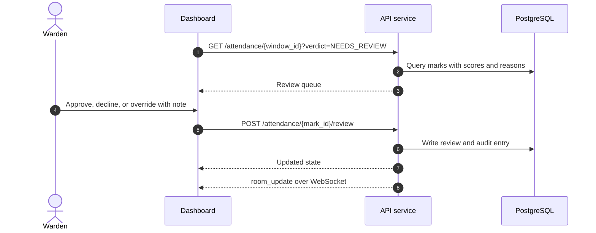
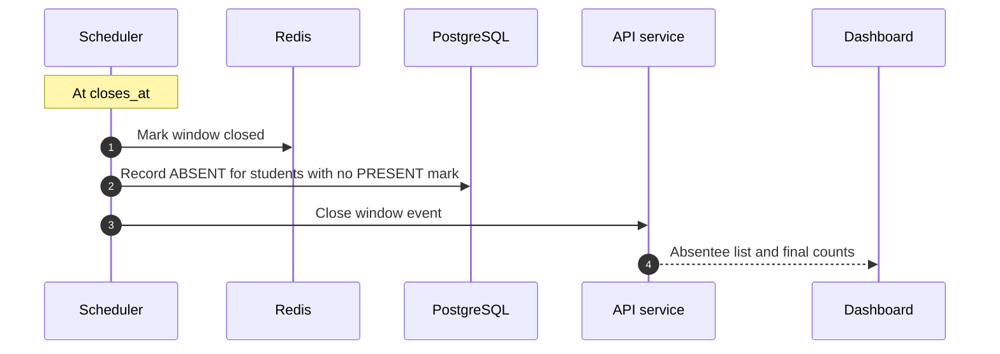
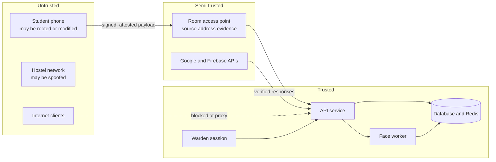
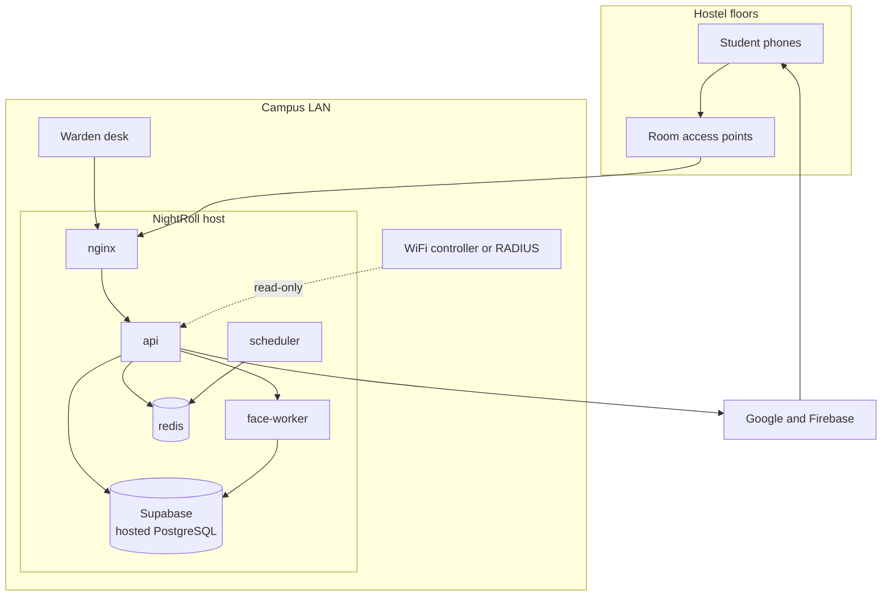

# NightRoll: Architecture

**Team:** Zero_Latency
**Event:** Genesis Hackathon
**Status:** Design stage
**Version:** 0.1
**Companion documents:** PRD, TRD, README

---

## 1. Overview

NightRoll is a hostel attendance system. A student marks attendance from bed on an Android phone, and the mark is accepted only if three things are proven together:

1. **The right person:** face match and a live challenge.
2. **The right place:** the request comes from the student's room network, backed by a WiFi fingerprint of the room.
3. **The right device, right now:** a hardware-bound key signs a one-time nonce issued for tonight's window.

The architecture is built around one principle: the phone gathers evidence, the hostel network vouches for location, and the backend decides. No single component is trusted alone.

---

## 2. Architectural drivers

| Driver | Why it matters | Architectural response |
|---|---|---|
| Hard to fake | The core product promise | Layered gates; device-bound keys; server-side decisions |
| No new hardware | Hostels rarely approve purchases quickly | Uses phone sensors, existing WiFi, and campus servers |
| Works in the hostel network | Source IP and WiFi are the location proof | Backend on the campus LAN |
| Short, predictable load | About 1,000 students in a 30-minute window | Stateless API, single database, Redis for time-bound state |
| Privacy of face data | Biometric data is sensitive | Embeddings only; frames deleted; separate face service with no attendance access |
| Explainable outcomes | Students and wardens need reasons | Fixed reason codes on every verdict |
| Fails safe | A wrong acceptance is worse than a rejection | Gates fail closed; ground-floor scanner as fallback |
| Demo-able in a hackathon | Judges must see it work | Demo runs on two routers and one laptop |

---

## 3. System context

**External systems**

| System | Role | Required? |
|---|---|---|
| Firebase Cloud Messaging | Delivers the window-open push | Yes |
| Google Play Integrity API | Confirms the app runs on a genuine, unmodified device | Yes |
| WiFi controller or RADIUS | Confirms which access point a client is on | No for MVP; yes for production |
| Ground-floor scanner | Fallback for dead phones and outages | Yes (existing) |

---

## 4. Container view

### 4.1 Containers

| Container | Responsibility | Talks to | Owns data |
|---|---|---|---|
| NightRoll app | Enrollment, challenge, capture, WiFi scan, signing | API (via AP), FCM, Keystore | Key alias only |
| Reverse proxy | TLS termination, routing, rate limits at the edge | API, dashboard | None |
| API service | Gates, scoring orchestration, fusion, window and review logic, WebSocket hub | Redis, Supabase PostgreSQL, Supabase Auth, face worker, Play Integrity, network adapter | Attendance records, via Supabase PostgreSQL |
| Scheduler | Opens and closes windows, issues nonces, triggers push, records absentees | Redis, API, FCM | Window state, via Redis |
| Face worker | Embedding and anti-spoof on frames | Supabase PostgreSQL (embeddings only), Supabase Storage | Frames, deleted after 24 hours |
| Network adapter | Reads client-to-AP association from controller or RADIUS | Controller or RADIUS, API | None |
| Dashboard | Room tiles, review queue, exports | API over HTTPS and WebSocket | None |
| Supabase PostgreSQL | Relational records and pgvector embeddings; hosted by Supabase | API, face worker | All durable records |
| Supabase Auth | Warden and admin login, MFA, JWT issuance | Dashboard, API | Warden and admin accounts |
| Supabase Storage | Private bucket for short-lived frames | Face worker | Frames, deleted after 24 hours |
| Redis | Nonces, window state, rate limits, live snapshot | API, scheduler | Short-lived state only |

### 4.2 Why these boundaries

- **Face worker is separate from the API.** Face work is CPU-heavy and uses different libraries. Separating it keeps verification responsive, and it lets the face model be upgraded without touching the gate logic.
- **Face worker cannot read attendance tables.** It only reads and writes embeddings and frames. A compromised face worker cannot change a verdict.
- **Scheduler is separate from request handling.** Window opening and closing must happen on time, even under load from verifications.
- **Network adapter is optional and behind an interface.** The MVP uses a subnet check; the controller can be added later without changing the verification flow.
- **Redis holds only time-bound state.** Nonces and window state expire on their own, so nothing needs cleaning up after the night.

---

## 5. Component view: API service

### 5.1 Verification pipeline

The pipeline runs in strict order. A failure at any stage stops the request.

1. **Ingress:** schema validation, session or device authentication, rate limit.
2. **Gates:** window, nonce, signature, integrity, environment, network. Nonce is consumed only after the signature check.
3. **Scorers:** face, liveness, room fingerprint, own access point, access point agreement. Scorers run in parallel where independent.
4. **Fusion:** weighted sum, then verdict thresholds.
5. **Verdict builder:** creates the mark, reason codes, and response. Writes the audit entry.
6. **Notify:** updates the WebSocket snapshot for the room.

### 5.2 Design decisions inside the API

- **Gates are a list, not nested conditionals.** Each gate is a small function returning pass or a reason code. New gates can be added without changing the others.
- **Scorers are pure functions.** Given inputs, they return a score and a reason. They are easy to test with recorded data and easy to re-run after a threshold change.
- **Thresholds are configuration.** Fusion reads weights and cutoffs at runtime, so the walk test can change them without a deploy.
- **Idempotent verification.** A repeated request with the same nonce returns the existing mark. Retries from a weak connection do not create duplicates.

---

## 6. Key flows

### 6.1 Window opening

### 6.2 Enrollment

### 6.3 Nightly marking

### 6.4 Warden review

### 6.5 Window close

---

## 7. State and data

### 7.1 Where state lives

| State | Location | Lifetime | Why there |
|---|---|---|---|
| Nonces | Redis | Until window closes | Fast, atomic consume, expires on its own |
| Window state | Redis and PostgreSQL | Window record kept; state expires | Redis for live checks; PostgreSQL for history |
| Students, rooms, devices | PostgreSQL | Long-lived | Relational integrity |
| Embeddings | Supabase PostgreSQL (pgvector) | Until student leaves | Vector search close to the record |
| Marks, reviews, audit | PostgreSQL | Per hostel policy | Durable and queryable |
| Frames | Encrypted file store | 24 hours | Kept only for audit of disputed marks |
| Device private key | Android Keystore | Life of the device | Never leaves hardware |

### 7.2 Consistency rules

- A student can have at most one PRESENT mark per window. Enforced by a partial unique index in PostgreSQL.
- A nonce can be consumed once. Enforced by an atomic Redis script.
- Window times are interpreted on the server clock only.
- Reviews never overwrite a mark. They add a review record, so the history stays intact.

---

## 8. Security architecture

### 8.1 Trust boundaries

### 8.2 Controls by boundary

| Boundary | Control |
|---|---|
| Phone to API | Device-bound signature; Play Integrity bound to the request hash; nonce |
| Network to API | Source IP must match room subnet; TLS |
| API to Google services | Service credentials; response verification |
| Warden to API | Supabase Auth with TOTP MFA; JWT expiry and refresh rotation |
| API to face worker | Internal network only; service token |
| Face worker to data | Limited to embeddings and frames; no attendance access |
| Any component to logs | No embeddings, frames, tokens, or unhashed student IDs |

### 8.3 What the architecture does not defend against

- A student who marks present and then leaves. Spot-checks are a later addition.
- A warden who abuses override. Mitigated by audit logging, not prevented.
- A compromised campus server. Mitigated by least privilege and backups, not by design of the app.
- A rooted phone that also gets a valid Play Integrity verdict. Rare; mitigated by the combination of other gates.

---

## 9. Deployment architecture

### 9.1 Pilot

One host on the campus LAN runs all server containers via Docker Compose. Phones reach it through the room access points. The warden's desk reaches it on the LAN.

### 9.2 Demo

Same containers on one laptop. Two routers provide two separate subnets. Phones connect to one or the other. No external controller; the subnet check does the network gate.

### 9.3 Scaling path

| Stage | Change | Trigger |
|---|---|---|
| Pilot | Single host | Default |
| Growth | Separate face worker host | Face latency above target |
| Multi-hostel | Supabase plan upgrade, managed Redis, load-balanced API | More than one hostel or hard uptime needs |
| Multi-campus | Per-campus deployment with shared code | Institutional roll-out |

Nothing in the design requires a rewrite to scale. Each container can move to its own host.

---

## 10. Quality attributes

| Attribute | Target | How the architecture meets it |
|---|---|---|
| Security | Each attack in the TRD threat list blocked by at least one control | Layered gates; no single trusted factor |
| Latency | p95 verdict under 2 seconds | Stateless API; face work in its own worker; atomic Redis operations |
| Availability | Available for the whole window | Fallback scanner; single-host recovery plan; daily backups |
| Privacy | Embeddings only; frames 24 hours | Face worker isolated; retention job; no biometric logs |
| Auditability | Every verdict and override recorded | Audit writer on every state change |
| Maintainability | New gate or scorer without touching others | Gates and scorers as pluggable units |
| Tunability | Thresholds change without deploy | Configuration-driven fusion |
| Explainability | Every non-PRESENT verdict has a reason | Fixed reason codes |

---

## 11. Architecture decisions

| # | Decision | Alternatives considered | Reason |
|---|---|---|---|
| ADR-1 | Verdict computed on the server, not the phone | Client-side decision | Phones can be modified; the server is the only trusted decider |
| ADR-2 | Device key in Android Keystore, non-exportable | Shared secret per student; password | Binds a mark to one physical device; survives account reuse attempts |
| ADR-3 | Play Integrity bound to the payload hash | Integrity token alone | Stops a valid token being reused for a different payload |
| ADR-4 | Nonce per student per window in Redis | Stateless timestamp | Single-use is enforced atomically; no replay within the window |
| ADR-5 | Subnet check first, controller or RADIUS later | Require controller access up front | Works without the network admin's cooperation; upgrades cleanly |
| ADR-6 | Face worker as a separate service with limited access | Face code inside the API | Isolates biometric data; scales independently |
| ADR-7 | Embeddings in pgvector on Supabase, not a separate vector database | Dedicated vector store | One fewer system to run; data volume is small |
| ADR-8 | WiFi fingerprint as a scored factor, not a gate | Hard gate on fingerprint | Fingerprints vary night to night; a gate would reject too many real students |
| ADR-9 | Fail closed on security gates | Fail open for availability | A wrong acceptance is worse than a rejection in this setting |
| ADR-10 | Single host for pilot | Cloud Kubernetes | Hostel scale does not justify it; easier for the team to operate |
| ADR-11 | React Native for the app | Flutter; native Kotlin | One codebase; team familiarity; camera and ML libraries available |
| ADR-12 | Android first, iOS deferred | Both platforms at once | iOS cannot perform full WiFi scans, which the design depends on |
| ADR-13 | Supabase for database, auth, and frame storage | Self-hosted PostgreSQL, a separate auth provider, and S3-compatible storage | One managed platform with pgvector, MFA-capable auth, and private buckets; less to operate in a hackathon and pilot |
| ADR-14 | Redis kept for nonces and window state | Supabase-only (Postgres with short TTL tables) | Atomic consume and TTL expiry are a natural fit for Redis; keeps the nonce path independent of database load |

---

## 12. Risks and open architectural questions

| Item | Type | Impact | Next step |
|---|---|---|---|
| Hostel network cannot provide subnets or controller access | Risk | Network gate limited to fingerprint and review | Confirm with network admin before pilot |
| Anti-spoof model too slow on pilot hardware | Risk | Latency target missed | Benchmark early on the target server |
| Play Integrity rejects some phones | Risk | Students locked out | Check device list; fallback in place |
| Single host failure during window | Risk | Attendance stops for the night | Fallback scanner; documented restore |
| Hosted Supabase acceptable under college data policy, or must frames stay on campus | Question | Affects where frames and data live | Confirm with college IT and hostel administration |
| Hosting location for the server | Question | Affects deployment and access | Confirm with college IT |
| Controller API or RADIUS format | Question | Affects adapter work | Obtain sample logs or API docs |

---

## 13. Glossary

| Term | Meaning |
|---|---|
| Window | Time range when marking is open, for example 22:00 to 22:30 |
| Nonce | One-time random value issued to a student for a window |
| Embedding | A 512-number vector representing a face, used for matching; not a photo |
| Liveness | Evidence that a real, moving face is present, not a photo or screen |
| Fingerprint | Pattern of visible WiFi access points and signal strengths in a room |
| BSSID | Unique identifier of a WiFi access point |
| Subnet | The range of IP addresses assigned to a room's network |
| Hard gate | A check that must pass before any scoring |
| Fusion | Combining scores into one verdict |
| Keystore | Android's secure storage for keys that cannot be extracted |
| Play Integrity | Google's check that an app runs on a genuine, unmodified device |